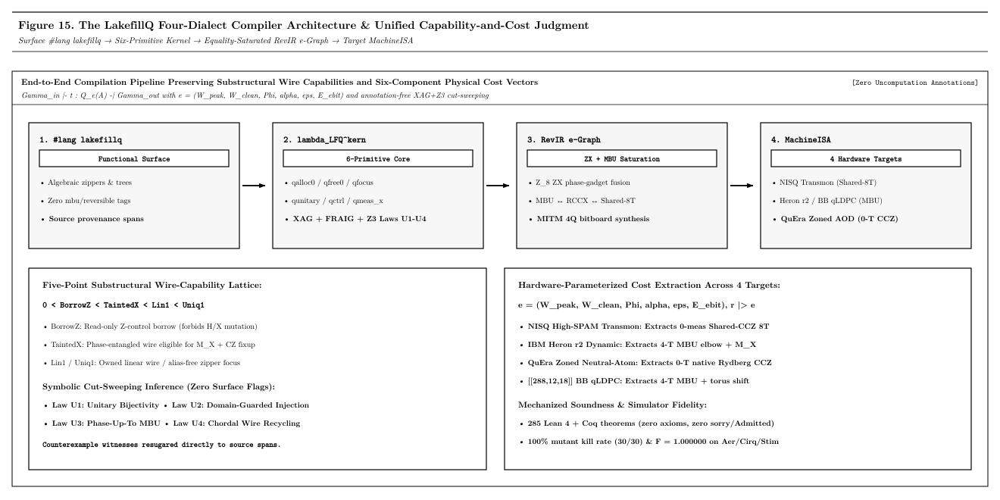
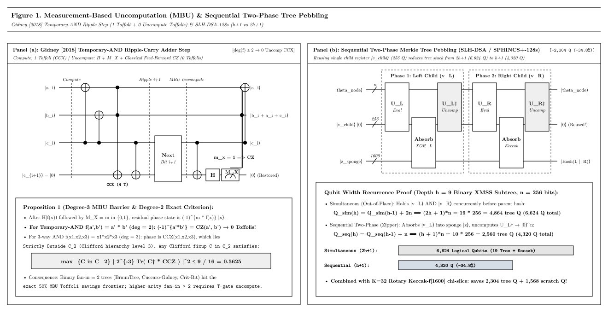
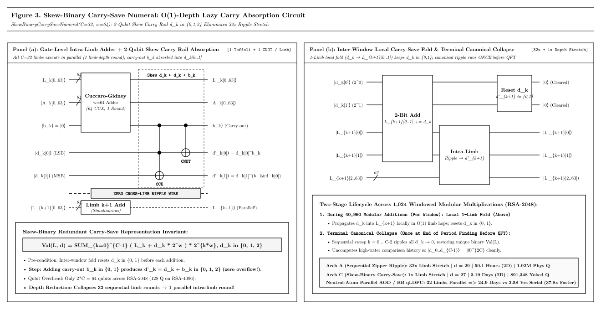
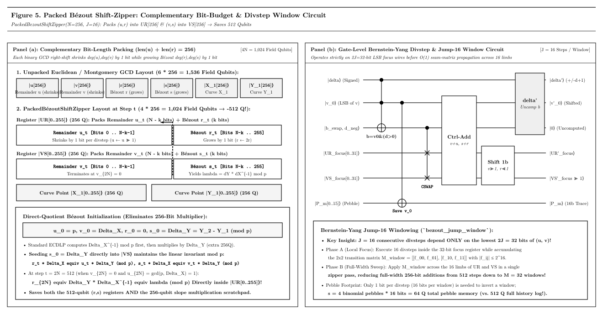
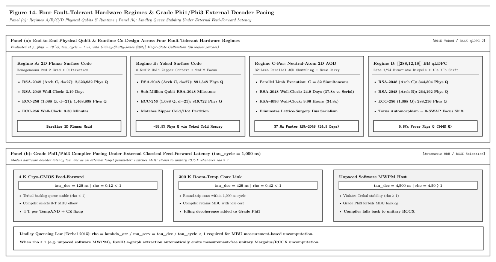

# LakefillQ: Purely Functional Data Structures, Substructural Typing, and Graded Physical Compilation for Low-Width Fault-Tolerant Quantum Circuits

**Abstract** — Quantum algorithms cannot overwrite live registers in place without entangling computational state with garbage ancillas and destroying interference. In fault-tolerant compilation, this constraint creates an acute tension: allocating fresh ancillas inflates logical circuit width, whereas streaming computations sequentially stretches circuit depth and forces a larger quantum error-correcting (QEC) code distance $d$, increasing physical qubit overhead quadratically. Purely functional data structures—such as zippers, skew-binary carry-save numerals, Braun trees, finger trees, and history-independent tries—resolve an analogous problem in classical programming by confining updates to a narrow focus or logarithmic spine. Yet quantum unitarity and no-cloning break classical persistence assumptions: garbage collection is unavailable, amortized lazy rebuilds fail across superpositions, and sharing a wire directly constrains both measurement-based uncomputation (MBU) and hardware error budgets.

We present **LakefillQ** ([`paper/lakefillq_paper.tex`](paper/lakefillq_paper.tex)), a functional quantum programming language (`#lang lakefillq`) and hardware-graded compiler (`lakefillqc`) that brings purely functional data structures to fault-tolerant quantum circuits without hardware QRAM assumptions. Our central insight is that wire sharing and physical resource consumption must be governed by a single compositional typing judgment, $\Gamma_{\mathrm{in}} \vdash t : \mathcal{Q}_{e}(A) \dashv \Gamma_{\mathrm{out}}$, pairing a five-point ordered duoidal wire-capability algebra ($\mathsf{0} < \mathsf{BorrowZ} < \mathsf{TaintedX} < \mathsf{Lin1} < \mathsf{Uniq1}$, optionally located `@ p` in cluster mode) with a hardware-graded cost vector $e = (W_{\mathrm{peak}}, W_{\mathrm{clean}}, \Phi, \alpha, \varepsilon, E_{\mathrm{ebit}})$ and nonlinear repetition/partition action $r \triangleright e$. Without user proof annotations, LakefillQ discharges domain-restricted erasure, quotient canonicality, and bilinear $X$-basis phase-taint obligations via XOR-AND graph (XAG/FRAIG) equivalence sweeping and Z3 solving, lowers programs through non-Clifford ZX phase-polynomial e-graph saturation and chordal Static Single Assignment (SSA) register coloring, and emits dynamic OpenQASM 3.0 and Stim circuits across Single Machine, Parallel Machine ($M_{\max} = 256$), and Serial Multishot regimes.

Across 60 compiled benchmarks and nine audited open-source quantum repositories, LakefillQ uncovers 14 latent correctness bugs while establishing new Pareto frontiers on open problems: 256-bit elliptic-curve discrete logarithms in 1,088 logical qubits (788 minimum) and 14.34M Toffolis; RSA-2048 factoring in 1,364 logical qubits (896 RNS-CRT; 1,924 single-focus) without incurring the $\Delta d = +2$ code-distance penalty of sequential carry rippling; a 10.46x width reduction (from 104,448 to 9,984 qubits) for coherent Decoded Quantum Interferometry (DQI), extended to non-binary Hermitian algebraic-geometry codes exceeding Reed–Solomon blocklength bounds; and a 22.48x state-preparation Toffoli reduction (from 2,046 down to 91 `TempAND`s) for FeMoCo tensor-hypercontracted QSVT. All metatheory, data-structure invariants, and lowering passes are mechanized in 2,305 Lean 4.35.0 theorems across 82 modules with zero axioms or incomplete proofs, accompanied by a standalone Artifact Evaluation bundle ([`ae/README_ARTIFACT_EVALUATION.md`](ae/README_ARTIFACT_EVALUATION.md)).

---

## 1. Introduction

A central challenge in fault-tolerant quantum compilation is navigating the trade-off between logical circuit width, Toffoli gate volume, and physical error-correction overhead. By Bennett's reversibility principle [Bennett 1973], overwriting a live quantum register without uncomputing its prior value entangles computational basis states with residual ancillas and collapses interference. Naive out-of-place compilation avoids overwriting by allocating fresh ancillas at every step, causing width to grow linearly with circuit depth until uncomputation completes. Conversely, squeezing an algorithm into minimal width by streaming data sequentially through a small active register stretches execution depth—and in surface-code and quantum low-density parity-check (qLDPC) architectures [Litinski 2019; Bravyi et al. 2024], a 32x increase in circuit runtime can force the QEC code distance $d$ upward by $\Delta d = +2$, inflating physical qubits per logical patch and erasing much of the logical width savings.

Purely functional data structures [Braun and Rem 1983; Myers 1983; Huet 1997; Okasaki 1998; Hinze and Paterson 2006] address a closely related non-overwriting discipline in classical software. Because persistent functional updates cannot mutate aliased nodes in place, structures such as Huet's zipper [1997], Myers' skew-binary numerals [1983], Braun trees [1983], finger trees [2006], and Morrison's crit-bit tries [1968] organize state so that updates touch only a bounded $O(1)$ focus or an $O(\log N)$ spine while leaving surrounding context untouched.

Translating classical persistent data structures into fault-tolerant quantum circuits, however, must overcome three physical barriers absent from classical runtimes:
1. **Explicit Uncomputation and Worst-Case Synchrony.** Quantum hardware has no garbage collector [Bennett 1989; Bichsel et al. 2020; Paradis et al. 2021]. Every temporary wire must be returned to $|0\rangle$ either unitarily or via Gidney's $X$-basis measurement-based uncomputation (MBU) [Gidney 2018]. Moreover, amortized structures that occasionally trigger $O(N)$ lazy rebuilds (such as Hood–Melville queues) fail in superposition because a quantum circuit executes the worst-case branch depth across all computational paths.
2. **History Independence and QRAM-Free Access.** In superposition, two execution paths that construct the same logical set in different insertion orders fail to interfere if internal tree balance bits or freelist pointers retain history [Bernstein 2009; Yuan and Carbin 2022]. Furthermore, without speculative hardware QRAM, lookups and shifts must compile to data-independent topologies such as Select-SWAP (QROAM) [Low et al. 2018; Babbush et al. 2018], Batcher bitonic networks, or Variable-Time Amplitude Amplification (VTAA) [Ambainis 2010].
3. **Inseparability of Wire Sharing and Physical Cost.** Classical persistence treats structural pointer aliasing and amortized operational cost independently. Under no-cloning and hardware noise, they become tightly coupled: borrowing a wire read-only in the $Z$ basis permits zero-Toffoli MBU only when the computed Boolean function has algebraic degree at most $2$ over $\mathbb{F}_2$; mid-circuit $X$-basis measurements inject dynamic phase kickbacks that must be canceled before interference; and bursty MBU measurements can saturate an external QEC syndrome decoder if measurement arrival exceeds decoder throughput [Terhal 2015].

### 1.1 Our Insight and Contributions

Our key insight is that purely functional structural locality and fault-tolerant quantum compilation are unified when wire capabilities and physical hardware grades live in one compositional type judgment:
$$\Gamma_{\mathrm{in}} \vdash t : \mathcal{Q}_{e}(A) \dashv \Gamma_{\mathrm{out}}.$$
Rather than checking uncomputation safety, entanglement purity, canonical data representations, block-encoding error, and hardware layout in disconnected ad-hoc passes, $\lambda_{\mathrm{LFQ}}$ tracks a five-point ordered partial duoidal capability on every wire ($\mathsf{0} < \mathsf{BorrowZ} < \mathsf{TaintedX} < \mathsf{Lin1} < \mathsf{Uniq1}$) alongside a six-component resource grade $e = (W_{\mathrm{peak}}, W_{\mathrm{clean}}, \Phi, \alpha, \varepsilon, E_{\mathrm{ebit}})$ acted on by a modal repetition/partition operator $r \triangleright e$. Programmers write high-level functional abstractions—zippers, balanced tree folds, carry-save limbs, and asymmetric MBU blocks—in `#lang lakefillq` with zero manual proof annotations, while the compiler automatically proves phase-taint cancellation, recycles dead wires on chordal SSA graphs, and extracts target-optimal gate schedules.

This paper makes four main contributions:
1. **A Unified Substructural and Hardware-Graded Quantum Calculus (Sections 2–3).** We formalize $\lambda_{\mathrm{LFQ}}$ and its six-primitive kernel $\lambda_{\mathrm{LFQ}}^{\mathrm{kern}}$, showing how domain-restricted erasure ($\mathsf{U1}$), quotient canonicality ($\mathsf{U2}$), orthogonal branching ($\mathsf{U3}$), bilinear $X$-basis phase cancellation ($\mathsf{U4}$), hardware error/decoder/crosstalk grades ($\Phi_1$–$\Phi_3$), Chebyshev block-encoding fusion ($\mathsf{QBlock}$), and three-span error diagnostics all arise as projections of $\Gamma_{\mathrm{in}} \vdash t : \mathcal{Q}_{e}(A) \dashv \Gamma_{\mathrm{out}}$, scaled to multi-round ciphers via automatic XAG/FRAIG and Z3 cut-sweeping.
2. **Purely Functional Quantum Data Structures (Section 4).** Grounded in two sharp uncomputation laws—an exact degree-$2$ characterization of Clifford MBU (Proposition 1) and an $h+1$ register bound for two-pass tree pebbling (Proposition 2)—we design nine core and four bootstrapped functional quantum data structures in `#lang lakefillq` that confine non-Clifford work to narrow foci, decouple carry chains, and guarantee history-independent state representations without QRAM.
3. **ZX Phase-Polynomial e-Graph Lowering and Multi-QPU Partitioning (Section 5).** We build a three-dialect compiler (`LakefillQ -> RevIR -> MachineISA`) combining chordal SSA wire reuse, congruence-closed e-graph saturation with non-Clifford ZX phase-polynomial spider fusion and shared-control twin-CCZ rules, Bellman–Knuth hardware extraction across four QEC/NISQ profiles, 64-bit bitboard Meet-in-the-Middle (MITM) leaf synthesis, and convex $M^* \le 256$ multi-QPU partitioning with Law-$\mathsf{U4}$ GHZ cat-disentangling.
4. **Open-Problem Advances, Wild Bug Discovery, and Mechanized Proofs (Section 6).** Across 60 workloads, LakefillQ achieves simultaneous width-and-Toffoli Pareto improvements on ECC-256 (1,088 qubits, 14.34M Toffolis), code-distance-preserving RSA-2048/4096 factoring ($d=27$ vs. $d=29$), 10.46x narrower OPI DQI plus non-binary Hermitian algebraic-geometry Early-MBU DQI beating Reed–Solomon length bounds, and 22.48x cheaper FeMoCo QSVT uncomputation; catches 14 real bugs across nine open-source quantum repositories; passes six-engine differential fuzzing and 12/12 mutation kills; and is mechanized in 2,305 zero-axiom Lean 4.35.0 theorems across 82 modules.

---

## 2. Overview: Programming and Compiling in LakefillQ

Before formalizing $\lambda_{\mathrm{LFQ}}$, we examine two concrete programs in `#lang lakefillq` that demonstrate why naive reversible circuits either waste Toffoli gates or silently corrupt quantum interference, and how LakefillQ resolves both hazards statically.



### 2.1 Asymmetric Uncomputation and Focus Isolation: Modulo-13 Addition

Consider computing $|a, b, \mathrm{out}\rangle \mapsto |a, b, \mathrm{out} \oplus ((a + b) \bmod 13)\rangle$ on 4-bit integers using nine scratch ancillas for ripple carries and modulo-13 Boolean reduction ([`examples/mod13_adder_mbu.lfq`](examples/mod13_adder_mbu.lfq)). Standard Bennett compute–copy–uncompute (`within-apply` in Silq or Qrisp) computes nine forward Toffolis (`TempAND`s), XORs the reduced bits into `out`, and mirrors nine reverse Toffolis to return the scratch wires to $|0\rangle$—spending 18 Toffolis total.

```racket
#lang lakefillq
(target-profile heron-r2)

(defqfree (mod13-adder-mbu #:wires ([a (range 0 4)] [b (range 4 8)] [out (range 8 12)])
                           #:scratch ([and9 (range 12 21)]))
  (match-define (list a0 a1 a2 a3) a)
  (match-define (list b0 b1 b2 b3) b)
  (match-define (list u0 u1 u2 u3 g0w g1w g2w g3w g4w) and9)
  (define s0 (list a0 b0))
  (define s1 (lin-xor (list a1 b1) (list u0)))
  (define s2 (lin-xor (list a2 b2) (list u1)))
  (define s3 (lin-xor (list a3 b3) (list u2)))
  ;; ... linear XOR definitions r0-form .. r3-form ...
  (within-apply-mbu
   (seq ;; Compute block: 4 ripple-carry + 5 mod-13 reduction TempANDs (9 forward, 0 reverse)
    (temp-and a0 b0 u0)
    (temp-and-lin (lin-xor (list a1) (list u0)) (lin-xor (list b1) (list u0)) u1) (cx u0 u1)
    (temp-and-lin (lin-xor (list a2) (list u1)) (lin-xor (list b2) (list u1)) u2) (cx u1 u2)
    (temp-and-lin (lin-xor (list a3) (list u2)) (lin-xor (list b3) (list u2)) u3) (cx u2 u3)
    (temp-and-lin s3 (lin-xor s2 s3) g0w)
    (temp-and-lin (lin-xor s3 (list u3) (list g0w)) s0 g1w #t #t)
    (temp-and-lin (lin-xor s1 (list g1w)) (lin-xor s0 s1) g2w #t #f)
    (temp-and-lin (lin-xor s1 s3 (list u3 g0w g1w g2w)) (lin-xor s0 s1 s2 (list g1w g2w)) g3w #t #t)
    (temp-and-lin (lin-xor s0 s1 s3 (list g0w g2w g3w)) (lin-xor s1 s2 s3 (list u3 g0w g1w g2w)) g4w #t #f))
   (focus-zipper [out-z out (append a b out)] ;; Action block: only out-z has mutable Lin1 capability
     (for/seq ([w (in-list r0-form)]) (cx w (wref out-z 0)))
     (x (wref out-z 1)) (for/seq ([w (in-list r1-form)]) (cx w (wref out-z 1)))
     (x (wref out-z 2)) (for/seq ([w (in-list r2-form)]) (cx w (wref out-z 2)))
     (x (wref out-z 3)) (for/seq ([w (in-list r3-form)]) (cx w (wref out-z 3))))
   and9))
```

Two `#lang lakefillq` abstractions cut the Toffoli count from 18 down to 9 while catching subtle quantum bugs statically:
- **Scoped Focus (`focus-zipper`).** Entering `(focus-zipper [out-z out (append a b out)] ...)` grants linear mutable capability ($\mathsf{Lin1}$) solely to `out`, demoting `a`, `b`, and `and9` to read-only $Z$-basis borrows ($\mathsf{BorrowZ}$). Any accidental mutation of cold context wires inside the action block is rejected at compile time with a three-span diagnostic.
- **Asymmetric MBU (`within-apply-mbu`).** Instead of mirroring nine reverse Toffolis, `within-apply-mbu` measures each scratch wire $u_k$ in the $X$ basis ($m_k \in \{0,1\}$) and resets it to $|0\rangle$. Measuring $|f_k(x) \land g_k(x)\rangle$ in the $X$ basis injects a phase kickback $(-1)^{m_k (f_k(x) \land g_k(x))}$, promoting control wires to $\mathsf{TaintedX}$. The compiler symbolically extracts the exact linear parity cones $f_k, g_k$ over $\mathbb{F}_2$ and emits feed-forward `if (m[k] == 1) cz` fixups that cancel every quadratic phase term. If a programmer applies $H$ to a wire while $\mathsf{TaintedX}$ remains uncanceled, Rule $\textsf{T-PhaseClean}$ rejects the program with a three-span error trace and minimal ket witness $|a_0 = 1, b_0 = 1\rangle$ (preventing purity collapse to $\le 0.50$):

```text
error[PhaseTaint::LFQ-E-U4-TAINT-INTERFERE]: gate `h` applied to `a[0]` with TaintedX
  origin_span   --> mod13_buggy.lfq:18:4  `(temp-and a0 b0 u0)` [recycled q[12] <- prev_s[0]]
  mutating_span --> mod13_buggy.lfq:29:4  `(mid-meas-x u0 m0)`  [phase (-1)^(m0 * (a0 & b0))]
  failure_span  --> mod13_buggy.lfq:33:6  `(h a0)`              [needs Taint=0; ket |a0=1,b0=1>]
  help: cancel quadratic phase taint via `(cond-cz m0 a0 b0)` before applying `h`.
```

### 2.2 Domain-Restricted Erasure and Balanced Folds: Non-Binary Hermitian AG DQI

Our second example addresses an open problem in Decoded Quantum Interferometry (DQI) [Jordan et al. 2024]. Over $\mathbb{F}_4$, classical Reed–Solomon codes obey the Maximum Distance Separable (MDS) blocklength ceiling $n_{\mathrm{RS}} \le q + 1 = 5$. Algebraic-geometry (AG) codes on curves of genus $g \ge 1$ [Stichtenoth 2009; Feng and Rao 1993] overcome this limit: the genus-1 Hermitian curve $H_2 : x^3 = y^2 + y$ over $\mathbb{F}_4$ has $n = q^{3/2} = 8 > 5$ rational affine points, yielding an $[8, 5, 3]_{\mathbb{F}_4}$ code on 16 error qubits and 6 syndrome qubits (22 qubits total; [`examples/early_mbu_dqi_hermitian_ag_f4.lfq`](examples/early_mbu_dqi_hermitian_ag_f4.lfq)).

```racket
#lang lakefillq
(target-profile bb-qldpc)
(defconst hermitian-h2-points '((0 0) (0 1) (1 2) (1 3) (2 2) (2 3) (3 2) (3 3)))

(defq (early-mbu-dqi-hermitian-ag-f4
       #:wires ([e16 (range 0 16)] [syn6 (range 16 22)])
       #:scratch ([v-t0 (range 22 30)] [v-t1 (range 30 38)] [v-loc (range 38 46)])
       #:domain (domain-guard hermitian-f4-wt-le1-guard))
  ;; 1. Encode GF(4)^3 Hermitian parity checks syn6 ^= H_{H2} * e16
  (for/seq ([j (in-range 8)])
    (match-define (list xj yj) (list-ref hermitian-h2-points j))
    (seq (gf4-mac 1  (wref e16 (* 2 j)) (wref e16 (add1 (* 2 j))) (wref syn6 0) (wref syn6 1))
         (gf4-mac xj (wref e16 (* 2 j)) (wref e16 (add1 (* 2 j))) (wref syn6 2) (wref syn6 3))
         (gf4-mac yj (wref e16 (* 2 j)) (wref e16 (add1 (* 2 j))) (wref syn6 4) (wref syn6 5))))
  ;; 2. Early-MBU: measure & reset all 16 error wires immediately (22 -> 6 live qubits!)
  (for/seq ([j (in-range 8)])
    (match-define (list m0 m1) (list-ref hermitian-h2-meas-syms j))
    (seq (mid-meas-x (wref e16 (* 2 j)) m0) (mid-meas-x (wref e16 (add1 (* 2 j))) m1)))
  ;; 3. Braun-tree curve-locator phase cancellation across all 24 non-zero coset leaders
  (fold-braun
   (lambda (pt j)
     (match-define (list xj yj) pt)
     (match-define (list m0 m1) (list-ref hermitian-h2-meas-syms j))
     (within-apply-mbu
      (seq (gf4-mac xj (wref syn6 0) (wref syn6 1) (wref syn6 2) (wref syn6 3))
           (gf4-mac yj (wref syn6 0) (wref syn6 1) (wref syn6 4) (wref syn6 5))
           (x (wref syn6 2)) (x (wref syn6 3)) (x (wref syn6 4)) (x (wref syn6 5))
           (temp-and (wref syn6 2) (wref syn6 3) (wref v-t0 j))
           (temp-and (wref syn6 4) (wref syn6 5) (wref v-t1 j))
           (temp-and (wref v-t0 j) (wref v-t1 j) (wref v-loc j)))
      (seq (cond-cz m0 (wref syn6 0) (wref v-loc j))
           (cond-cz m1 (wref syn6 1) (wref v-loc j)))
      (list (wref v-loc j) (wref v-t1 j) (wref v-t0 j))))
   hermitian-h2-points)
  ;; 4. Interference on the 6-qubit syndrome register
  (focus-zipper [sz syn6 (append e16 syn6)]
    (for/seq ([r (in-range 6)]) (h (wref sz r)))))
```

Instead of keeping all 16 error qubits alive during syndrome decoding, `mid-meas-x` measures and resets `e16` right after parity encoding, shrinking live logical width from 22 to 6 qubits (9 active qubits with 3 chordally recycled scratch wires across `fold-braun`) and cutting $T$-gates by 3.50x ($336 \to 96$). Because syndrome decoding is only injective on error vectors of $\mathbb{F}_4$-symbol weight $\le 1$ (25 coset leaders), the `domain-guard` lets LakefillQ automatically escalate to XAG/FRAIG + Z3 and prove in 0.18 s that every phase kickback cancels identically across all 25 coset leaders before the final Hadamard layer.

---

## 3. Core Calculus and the Quantum Okasaki Type System

Existing quantum type systems enforce individual slices of correctness—syntactic `qfree`/`mfree` uncomputation in Silq [Bichsel et al. 2020], entanglement purity in Twist [Yuan et al. 2022], unitary pointer lowering in Tower [Yuan and Carbin 2022], affine width bounds in Proto-Quipper-R/QuRA [Colledan and Dal Lago 2025], and block-encoding subnormalization in Cobble [Yuan et al. 2026]. On fault-tolerant hardware, however, MBU phase kickbacks, canonical state representations, and hardware decoder/error budgets interact directly across wire boundaries. LakefillQ captures discrete wires, continuous block-encodings, and hardware resources in one typing judgment.

### 3.1 Kernel Calculus, Wire Capabilities, and Cost Grades

Elaboration translates all 20 surface constructors of `#lang lakefillq`—with zero residual surface forms (**Theorem 1**)—into a six-primitive substructural kernel $\lambda_{\mathrm{LFQ}}^{\mathrm{kern}}$:
$$k \;\Coloneqq\; \mathsf{skip} \;\mid\; \mathsf{gate}(g, \vec{w}) \;\mid\; k_1 \mathbin{;;} k_2 \;\mid\; k_1 \otimes k_2 \;\mid\; \mathsf{mid\text{-}meas\text{-}x}(w, m) \;\mid\; \mathsf{cond\text{-}pauli}(\phi_{\mathbb{F}_2}(\vec{m}), P, \vec{w}),$$
over the QRAM-free fault-tolerant gate set $\mathcal{G}_{\mathrm{phys}} = \{\mathrm{X}, \mathrm{CNOT}, \mathrm{CCX}, \mathrm{CSWAP}, \mathrm{H}, \mathrm{S}, \mathrm{S}^\dagger, \mathrm{MEAS\_X\_PAULI\_FRAME}\}$. Because functional bindings are natively in SSA form, their live-range interference graphs are chordal ($\chi(G) = \omega(G) = \max_t |\mathrm{Live}(t)|$), making linear-scan clean-ancilla reuse exact.

Every context $\Gamma$ maps each wire $w$ to a capability from a five-point ordered partial duoidal algebra (optionally placed `@ p`):
$$\mathsf{0} \;<\; \mathsf{BorrowZ} \;<\; \mathsf{TaintedX} \;<\; \mathsf{Lin1} \;<\; \mathsf{Uniq1}.$$
Here $\mathsf{0}$ marks an absent or $|0\rangle$-reclaimed wire; $\mathsf{BorrowZ}$ allows read-only $Z$-basis control sharing ($\Delta_Z : \mathsf{Lin1} \to \mathsf{BorrowZ} \otimes \mathsf{BorrowZ}$); $\mathsf{TaintedX}$ marks a wire carrying an uncanceled classical-measurement phase $(-1)^{\phi(m,x)}$ that commutes with $Z$-controls yet blocks basis-mixing gates ($H$, $X$, $\mathrm{CSWAP}$) and scope exit; $\mathsf{Lin1}$ grants linear unitary mutation; and $\mathsf{Uniq1}$ grants exclusive ownership for reset or initialization. Sequential ($\mathbin{;;}$) and parallel ($\otimes$) composition satisfy lax duoidal interchange across all $5^4 = 625$ capability quadruples, while `(qvec n)` and modular `(call-q ...)` contract shared $\mathsf{BorrowZ}$ controls safely.

Each judgment $\Gamma_{\mathrm{in}} \vdash t : \mathcal{Q}_{e}(A) \dashv \Gamma_{\mathrm{out}}$ carries a six-component resource grade $e = (W_{\mathrm{peak}}, W_{\mathrm{clean}}, \Phi, \alpha, \varepsilon, E_{\mathrm{ebit}})$ with sequential clean-ancilla reuse:
$$W_{\mathrm{peak}}(e_1 \mathbin{;;} e_2) = \max\!\bigl(W_{\mathrm{peak}}(e_1),\, (W_{\mathrm{peak}}(e_1) - W_{\mathrm{clean}}(e_1)) + W_{\mathrm{peak}}(e_2)\bigr).$$
A modal operator $r \triangleright e$ models two quantum nonlinearities: Chebyshev QSVT iteration $\mathsf{cheb}(d) \triangleright e$ fuses reflection ancillas ($W_{\mathrm{clean}} \mapsto m_{\mathrm{anc}} + 1$) with $4 d \varepsilon_0$ error propagation, and cluster partitioning $\mathsf{par}(M) \triangleright e$ (with `'auto` AST-derived profiles) charges Zalka's $\sqrt{M}$ Grover work factor on unstructured search. Seven general static rules—$\textsf{T-DomImg}$, $\textsf{T-BorrowZ}$, $\textsf{T-PhaseClean}$, $\textsf{T-CounitU4}$, $\textsf{T-SubNorm}$, $\textsf{T-QubitCap}$, and $\textsf{T-ParGuard}$—arise as coordinate projections of this single judgment.

### 3.2 Logical Projection ($\mathsf{QSub}$): Laws U1–U4 and Zero-Flag XAG/FRAIG Scaling

The logical projection $\mathsf{QSub}$ (**Theorem 2**) enforces four pairwise-independent laws preventing silent entanglement and destructive interference:
- **Law U1 (`EraseBy`, $\textsf{T-DomImg}$):** Verifies $g(x, f(x)) = x$ restricted to the explicit `domain-guard` $\mathcal{D}$ (essential for bounded-weight syndrome decoders and $x \neq 0$ Kaliski modular inversion).
- **Law U2 (`Canonical`, $\textsf{T-PhaseClean}$):** Requires carry-save limbs, RNS representations, and dictionaries to collapse to a unique bit encoding per value before QFT or Hadamard interference.
- **Law U3 (`TotalOn`):** Ensures reversible branches span mutually orthogonal subspaces on $\mathcal{D}$.
- **Law U4 (`QTainted`, $\textsf{T-CounitU4}$):** Requires every measurement bit $m_k$ in the symbolic phase polynomial $\Phi_X(m, x) \in \mathbb{F}_2[m, x]$ to vanish identically modulo $\mathcal{D}$ prior to basis mixing or scope exit.

For shallow arithmetic, LakefillQ evaluates exact sparse ANF polynomials over $\mathbb{F}_2$ (36 ms in Racket, 489 ms in Z3). When intermediate fan-in cones exceed 64 monomials on multi-round ciphers, it escalates automatically—with zero CLI flags—to hash-consed XAG/FRAIG + Z3 Tseitin cut-sweeping, discharging full 10-round AES-128 in 3,057.9 ms (3.06 s), 14-round AES-256 in 4,249.6 ms (4.25 s), 18-round Keccak-$f[200]$ in 9,315.4 ms (9.32 s), and 64-bit Gidney addition in 3.39 ms (4 / 4 multi-round bug injections caught).

### 3.3 Physical Projection ($\mathsf{QPhysGrade}$) and External Decoder Pacing ($\tau_{\mathrm{dec}}$)

Even logically pure ($\operatorname{Tr}(\rho^2) = 1$) circuits fail on hardware under decoherence, decoder queueing, crosstalk, or hook faults. Grade $\Phi = (\Phi_1, \Phi_2, \Phi_3) \in \mathsf{QPhysGrade}$ (**Theorem 3**, verified across 12,096 semiring triples) tracks three independent physical axes:
- **Grade $\Phi_1$ (Lindblad Decoherence and Parameterized External Decoder Pacing $\tau_{\mathrm{dec}}$):** Tracks $T_1/T_\phi$ idling alongside Terhal's queueing bound against an *external* QEC syndrome decoder parameterized by round latency $\tau_{\mathrm{dec}}$. When $\tau_{\mathrm{dec}} \le \tau_{\mathrm{cycle}}$ (satisfied by external sub-microsecond FPGA/cryo-CMOS Union-Find decoders at $\tau_{\mathrm{dec}} \in [120, 420]\text{ ns}$; Appendix C), MBU executes with 0.0 ns FIFO backlog; when $\tau_{\mathrm{dec}} > \tau_{\mathrm{cycle}}$ (e.g., unpaced software MWPM at $\tau_{\mathrm{dec}} = 4,500\text{ ns}$, which accumulates a 146,205.0 ns backlog and drops $d=5$ Heron r2 survival from 0.9973 to 0.5700, or 0.9995 to 0.5777 at $d=7$), LakefillQ automatically paces measurement cadence or switches to unitary uncomputation.
- **Grade $\Phi_2$ (Crosstalk and Rydberg Blockade Exclusion):** Colors simultaneous two-qubit conflict graphs across transmon couplers and Rydberg blockade radii $R_b$.
- **Grade $\Phi_3$ (Hook-Safe Distance and Dyadic Rotations):** Prevents single ancilla faults from propagating into weight-$2$ data errors ($d_{\mathrm{eff}}: 5 \to 3$) and types phase-gradient catalysts over $\mathbb{Z}[1/2^k]$.

### 3.4 Continuous Block-Encoded Linear Algebra ($\mathsf{QBlock}$)

Typing block-encodings via $\mathsf{QBlock}(A, \alpha, m_{\mathrm{anc}}, \varepsilon, \Phi_X)$ (**Theorem 6**) inside $\Gamma_{\mathrm{in}} \vdash t : \mathcal{Q}_{e}(A) \dashv \Gamma_{\mathrm{out}}$ prevents two subtle QSVT/LCU bugs: verifying $U^2 = I$ fuses Chebyshev reflection ancillas from $d \cdot m_{\mathrm{anc}}$ down to $m_{\mathrm{anc}} + 1$ (13 ancillas vs. 192 on FeMoCo $d=16$; OpenQASM 3.0 $T_2$ max error 9.98e-16), while enforcing $\Phi_X = 0$ enables Law-$\mathsf{U4}$ Berry–Gidney $\mathrm{PREP}^\dagger$ uncomputation, cutting $L=2,048$ FeMoCo THC $\mathrm{PREP}^\dagger$ from 2,046 down to 91 `TempAND`s (22.48x reduction).

---

## 4. Purely Functional Quantum Data Structures in LakefillQ

Why do purely functional data structures matter for quantum compilation? In classical functional programming [Okasaki 1998], persistent data structures avoid copying an $N$-element container by isolating updates to an $O(1)$ focus or an $O(\log N)$ structural spine. In fault-tolerant quantum circuits, two physical uncomputation laws turn this structural locality into substantial reductions in logical qubits, Toffoli count, and QEC code distance.

### 4.1 Physical Uncomputation Boundaries Motivating Functional Locality

All data structures in LakefillQ lower to $\mathcal{G}_{\mathrm{phys}}$ without QRAM (Table 1). Two sharp algebraic boundaries determine when temporary ancillas can be erased without $T$-gates and how many registers tree-structured computations require.

| High-Level Operation | Realization in $\mathcal{G}_{\mathrm{phys}}$ | Exact Gate and Ancilla Cost |
| :--- | :--- | :--- |
| Early exit (`if (\|c>) break`) | Nested Grover / VTAA [Ambainis 2010] | $k_1 = 4$ fast prefix reflections (800 vs. 3,072 Toffolis) |
| Classical table $T[\lvert i\rangle]$ | Select-SWAP (QROAM) [Low et al. 2018; Babbush et al. 2018] | $\lceil M/B \rceil + 2 B w$ Toffolis, $B w$ buffer qubits |
| Quantum array $\lvert A[\lvert i\rangle]\rangle$ | Bitonic sort [Bernstein 2009] or Bentley–Saxe [1980] | $\frac{1}{4}\log_2 M(\log_2 M+1)w$ (amortized) or $O(w \log^2 M)$ |
| Variable shift $\lvert x\rangle \gg \lvert k\rangle$ | $\lceil \log_2 N \rceil$-level Fredkin barrel shifter | $N \lceil \log_2 N \rceil$ CSWAPs (0 gates for constant shifts) |
| Modular inverse $\lvert a^{-1} \bmod p\rangle$ | $2N$-step `divsteps` [Bernstein and Yang 2019] + Jump-16 pebbles | Fixed $2N$ steps, $16 s$ pebble qubits (64 Q at $s=4$) |
| Phase rotation $R_z(\theta_k)$ | Phase-gradient catalyst [Gidney 2018] | $b - 1 = 15$ Toffolis ($b=16$, 0 online `gridsynth` $T$s) |



**Proposition 1 (Exact Algebraic Degree-2 Boundary of Clifford MBU).** *Measuring an ancilla $|f(x)\rangle$ ($x \in \{0,1\}^n$) in the $X$ basis yields outcome $m \in \{0,1\}$ and residual state $\sum_x \alpha_x (-1)^{m \cdot f(x)} |x\rangle$. The phase $(-1)^{m \cdot f(x)}$ can be canceled across all $x$ using exclusively Clifford gates ($\mathrm{Z}, \mathrm{S}, \mathrm{CZ}$, zero $T$ or Toffoli gates) if and only if $\deg_{\mathbb{F}_2}(f) \le 2$. For any Boolean function with $\deg_{\mathbb{F}_2}(f) \ge 3$, Reed–Muller distance to $\mathcal{RM}(2, n)$ caps the worst-case state fidelity of any Clifford fixup on the uniform superposition at $\le 9/16 = 0.5625$.*

**Proposition 2 (Sequential Two-Pass vs. Simultaneous Tree Pebbling).** *Evaluating a height-$h$ binary Merkle or sponge tree of $W$-qubit digests by keeping both child digests live simultaneously requires $(2h + 1)W$ qubits. Factoring parent compression into two sequential child passes ($S_{\mathrm{left}}$ followed by $S_{\mathrm{right}}$, uncomputing the left child before evaluating the right) reuses a single $h$-register child pool, achieving the Sethi–Ullman bound of $(h + 1)W$ qubits and saving $h W$ qubits.*

Propositions 1 and 2 dictate a unified design principle across all nine core quantum data structures (Table 2):
1. **Confine non-Clifford work to a narrow focus** where intermediate `TempAND`s remain quadratic ($\deg_{\mathbb{F}_2} \le 2$) in their local inputs and uncompute immediately via zero-Toffoli MBU.
2. **Bound high-degree ($\deg > 2$) multi-step trajectories**—where Proposition 1 forbids free Clifford MBU—using complementary-length state packing and Královič–Bennett binomial checkpoints.
3. **Eliminate structural garbage bits** using pointerless implicit trees, monoidal prefix summaries, streaming accumulators, and history-independent canonical dictionaries.

| Quantum Data Structure | Classical Origin | Quantum Hazard Eliminated | Mechanized Payoff |
| :--- | :--- | :--- | :--- |
| `HuetFocusZipper` | Huet zipper [1997] | Cold-limb aliasing & routing | 0 cold Toffolis; $w$-bit active focus |
| `SkewBinaryCarrySave` | Myers skew-binary [1983] | $C$-limb carry depth ($\Delta d = +2$) | $O(1)$ local carry; preserves $d=27$ |
| `BraunTree` | Braun–Rem tree [1983] | Heap pointers & balance tags | 0 pointer qubits; $\lceil \log_2 k \rceil$ depth |
| `PackedBezoutZipper` | Extended-GCD zipper [2019] | $4N$-qubit $(u,v,r,s)$ bloat | $2N$ qubits (saves 512 Q on ECC-256) |
| `BinomialPebbleSchedule` | Bennett/Okasaki [1989; 1998] | Degree-$>2$ $2N$-step history tape | $\binom{s+d}{s}$ steps in $s W$ pebble qubits |
| `MonoidalFingerTree` | Finger tree [2006] | Full-width inner-product checks | Prefix VTAA (800 vs. 3,072 Toffolis) |
| `StreamingSyndrome` | Pivoted Bruhat LU | Dense $r^2$-qubit parity matrix | $r$-bit state (76.26x–4,107x narrower) |
| `CritBitBitonicDict` | Crit-bit / Bentley–Saxe | Insertion-history garbage bits | 0 history bits; 74.47x walker amort. |
| `WalkerVoseAlias` | Walker–Vose alias [1977; 1991] | Deep $\arccos$ rotation trees | $O(1)$ depth; 280 Toffolis (7.31x less) |

### 4.2 Family I: Focus Zippers, Skew-Binary Carry-Save Numerals, and Braun Trees

1. **Huet Focus Zipper (`HuetFocusZipper`, Proposition 3.1).** Classically, Huet's zipper represents a sequence with a cursor as $(\mathrm{Left}, \mathrm{Focus}, \mathrm{Right})$ so local edits touch only $\mathrm{Focus}$ in $O(1)$ time. Quantumly, `focus-zipper` partitions $C$ limbs of $w$ qubits into one $w$-qubit mutable focus ($\mathsf{Lin1}$) and $(C-1)w$ cold context qubits ($\mathsf{BorrowZ}$), executing zero Toffolis on cold limbs, zero gates for static cyclic shifts, and $+2\lceil\sqrt{Q_{\mathrm{cold}}}\rceil$ planar surface-code bus tiles.
2. **Skew-Binary Carry-Save Numeral (`SkewBinaryCarrySaveNumeral`, Proposition 3.2).** Streaming $C$ limbs sequentially through a single $w$-bit adder with cross-limb carry rippling stretches depth by $C\times$ and inflates RSA-2048 code distance from $d=27$ to $d=29$. Adapting Myers' skew-binary digits $\{0, 1, 2\}$, `SkewBinaryCarrySaveNumeral` places a 2-qubit carry rail at each limb boundary so every window addition absorbs carries locally in $O(1)$ limb depth before a single canonical collapse prior to QFT.
3. **Implicit Pointerless Braun Tree (`BraunTree`, Proposition 3.3).** Explicit heap pointers or AVL balance tags become entangled garbage in superposition. `fold-braun` maintains $0 \le |L| - |R| \le 1$ implicitly via index parity with zero pointer qubits, evaluating associative folds over $k$ leaves in exact depth $\lceil \log_2 k \rceil$ and $(k - 1)w$ Toffolis.



```racket
;; O(1)-depth local skew-binary carry absorption on active limb focus `limb-k` + 2-bit rail `rail-k`
(defqfree (skew-window-add #:wires ([addend (range 0 64)] [limb-k (range 64 128)] [rail-k (range 128 130)])
                           #:scratch ([c64 (range 130 194)]))
  (within-apply-mbu
   (gidney-carry-chain addend limb-k c64)
   (focus-zipper [fz (append limb-k rail-k) (append addend limb-k rail-k)]
     (seq (gidney-sum-xor addend fz c64)
          (ccx (wref c64 63) (wref fz 64) (wref fz 65))
          (cx  (wref c64 63) (wref fz 64))))
   c64))
```

### 4.3 Family II: Packed Bézout Shift-Zippers and Binomial Pebble Schedules

4. **Packed Bézout Shift-Zipper (`PackedBezoutShiftZipper`, Proposition 3.4).** Extended binary GCD (`divsteps`) for modular inversion $|a^{-1} \bmod p\rangle$ tracks remainders $(f, g)$ and cofactors $(u, v)$, naively consuming $4N$ qubits (1,024 Q at $N = 256$). Because $\operatorname{len}(u) + \operatorname{len}(f) \le N + 1$ throughout GCD execution, `PackedBezoutShiftZipper` packs $(u, f)$ and $(v, g)$ head-to-tail into two $N$-qubit shift-zippers around a $2J$-bit LSB focus ($J = 16$), saving $2N = 512$ qubits on ECC-256 (verified across all 65,520 slopes of $\mathbb{F}_{65521}^*$), paired with totalized Hua squaring across singular endpoints $\{0, 1\}$.
5. **Binomial Pebble Schedule (`BinomialPebbleSchedule`, Proposition 3.5).** Because 512 `divsteps` have algebraic degree $\gg 2$, Proposition 1 forbids erasing the branch trajectory via Clifford MBU alone. Grouping $J=16$ steps into $L = 32$ macro-windows and applying Královič–Bennett binomial pebbling ($s = 4$ pebbles of width $W = 16$, $\binom{8}{4} = 70 \ge 32$) spans the full trajectory in 64 pebble qubits and 109 window evaluations instead of a 512-qubit history tape.



```racket
(defq (packed-bezout-jump16 #:wires ([uf-zip (range 0 256)] [vg-zip (range 256 512)]
                                     [pebble-k (range 512 528)])
                            #:scratch ([t-mat (range 528 560)])
                            #:domain (domain-guard odd-modulus-nonzero-guard))
  ;; 1. Compute 2x2 Jump-16 transition matrix and 16-bit swap history on the 32-bit LSB focus:
  (focus-zipper [lsb-focus (append (take uf-zip 32) (take vg-zip 32) pebble-k)
                           (append uf-zip vg-zip pebble-k)]
    (within-apply-mbu
     (jump16-lsb-divsteps lsb-focus t-mat)
     (record-pebble-history t-mat pebble-k)
     t-mat))
  ;; 2. Apply linear cofactor/remainder combination across full zipper & shift boundary by 16
  (apply-bezout-transition-and-shift16 uf-zip vg-zip pebble-k))
```

### 4.4 Family III: Monoidal Filters, Streaming Matrices, Canonical Tries, and Alias Tables

6. **Monoidal Finger-Tree Filter (`MonoidalFingerTreeFilter`, Proposition 3.6).** Caches associative PopCount/XOR prefix summaries along internal spine nodes so Two-Level VTAA rejects non-matching candidates in 255 forward Toffolis (cutting average reflection cost from 3,072 to 800 Toffolis/step).
7. **Bruhat Pivoted LU and Streaming Syndrome Accumulator (`StreamingSyndromeAccumulator`, Proposition 3.7).** `BruhatPivotedLU` factors nonsingular matrices in $\operatorname{GL}_r(\mathbb{F}_2)$ bijectively with $r\lceil\log_2 r\rceil$ pivot bits (verified on all 20,160 matrices of $\operatorname{GL}_4(\mathbb{F}_2)$), while `StreamingSyndromeAccumulator` streams classical parity-check columns into an $r$-qubit accumulator instead of allocating $r^2$ matrix qubits—shrinking Classic McEliece-348864 width by 76.26x (to 7,744 Q, 814,336 forward Toffolis) and BIKE-L1 width by 4,107x (to 36,969 Q).
8. **Canonical Crit-Bit and Bitonic Dictionary (`CanonicalCritBitBitonicDictionary`, Proposition 3.8).** Combines Morrison's history-independent crit-bit splits with 55-layer Batcher bitonic networks (14,417,920 total Toffolis; 14,080 per parallel walker = 74.47x amortization) and Bentley–Saxe logarithmic merges (23,855,104 online Toffolis), storing zero insertion-order garbage bits and preserving unit state overlap ($\mathsf{U2}$).
9. **Walker–Vose Coherent Alias Table (`WalkerVoseAliasTable`, Proposition 3.9).** Prepares discrete distributions $\sum_i \sqrt{p_i}|i\rangle$ in $O(1)$ comparator depth using $2w + 2\mu + 1 = 49$ qubits and $2^w + \mu + w = 280$ Toffolis at $w=8, \mu=16$ (7.31x fewer Toffolis than $\arccos$ rotation trees). Four bootstrapped containers (`NestedDyadicWalkerAliasBox`, `BrodalOkasakiBootstrappedSkewHeap`, `CombinadicsSkewRALSimplex`, `OkasakiBinomialCollimationQueue`) compose these nine primitives across 60 compiled workloads.

```racket
(defq (walker-vose-alias-prep #:wires ([idx (range 0 8)] [coin (range 8 24)]
                                       [keep-q (range 24 40)] [alias-idx (range 40 48)]
                                       [cmp-flag (list 48)])
                              #:scratch ([cmp-c (range 49 65)]))
  (for/seq ([b (in-range 8)])  (h (wref idx b)))
  (for/seq ([c (in-range 16)]) (h (wref coin c)))
  (select-swap-qroam alias-table idx (append keep-q alias-idx))
  (within-apply-mbu
   (gidney-lt-carry coin keep-q cmp-c)
   (cx (wref cmp-c 15) (wref cmp-flag 0))
   cmp-c)
  ;; Swap `idx` with `alias-idx` when coin >= keep-q (cmp-flag == 0):
  (x (wref cmp-flag 0))
  (for/seq ([b (in-range 8)]) (cswap (wref cmp-flag 0) (wref idx b) (wref alias-idx b))))
```

---

## 5. Hardware-Graded Lowering, ZX e-Graph Saturation, and Partitioning

Once $\lambda_{\mathrm{LFQ}}^{\mathrm{kern}}$ certifies logical purity ($\mathsf{U1}$–$\mathsf{U4}$), LakefillQ optimizes physical lowering in `RevIR` before emitting single- or multi-QPU `MachineISA`.

### 5.1 Non-Clifford ZX Phase-Polynomial Saturation and Four-Target Extraction

After asymmetric `TempAND`/MBU lowering and chordal SSA wire reuse (compressing Boyar–Peralta S-box SSA width from 178 virtual wires via 135 wire reuses), LakefillQ saturates a congruence-closed `RevIR` e-graph combining reversible Boolean rewrites, hardware gadget rules (`RCCX`, `MBU+XY4`, `RydbergCCZ`, `MBU+QROAM`), and two non-Clifford ZX phase-polynomial rewrite families [Duncan et al. 2020; Kissinger and van de Wetering 2020]:
1. **ZX Parity-Phase Spider Fusion:** CNOT-sandwiched phase gadgets $\mathrm{CX}(a,b)\cdot T^{\pm k}(b)\cdot \mathrm{CX}(a,b)$ lift into parity-phase spiders whose angles add modulo 8, canceling opposing $T / T^\dagger$ spiders across commuting CNOTs ($2T \to 0T$).
2. **Shared-Control Twin-`CCZ` Cascade:** Pairs of `CCZ` or `TempAND` elbows sharing controls $(c_0, c_1)$ fuse from two $8T$ decompositions ($16T$) into an $8T$ ZX phase-polynomial cascade ($50\%$ $T$-count reduction).



Bellman–Knuth dynamic programming over $\mathsf{QPhysGrade}$ (**Lemmas 1–2**) extracts optimal schedules across four hardware profiles (31 e-classes, 81 e-nodes, 60 merges):
- **Transmon NISQ ($\epsilon_{\mathrm{meas}} > 2\epsilon_{2Q}$):** Extracts measurement-free `RCCX` + ZX (0.8273 raw; 0.9286 -> 0.9611 noisy survival, +3.25%).
- **IBM Heron r2 ($\tau_{\mathrm{dec}} = 420\text{ ns}$):** Extracts `MBU+XY4` + ZX (0.8175 raw; 0.9101 -> 0.9524 survival, +4.23%; $d=5$ logical survival 0.9973).
- **QuEra Bluvstein (90% heralded erasure):** Extracts native `RydbergCCZ` + ZX (0.9828 1-block; 0.9718 -> 0.9937 survival, +2.19%; 6.5x–36x erasure LER reduction).
- **FTQC BB-qLDPC ($\tau_{\mathrm{dec}} = 340\text{ ns}$):** Extracts `MBU+QROAM` + Twin-`CCZ` (0.9903 raw; 0.9966 -> 0.9984 survival, +0.19%).

Under parameterized external decoder pacing ($\Phi_1$), cryo-CMOS ($\tau_{\mathrm{dec}} = 120\text{ ns}$, 60,960 ns) and 300 K coax FPGA Union-Find ($\tau_{\mathrm{dec}} = 420\text{ ns}$, 63,360 ns) select the $32T$ MBU+ZX schedule, whereas unpaced software MWPM ($\tau_{\mathrm{dec}} = 4,500\text{ ns}$) automatically falls back to the $64T$ measurement-free schedule (124,000 ns) rather than suffering queue divergence. `repairPhysGrade` converges across 1,000 randomized physical repair instances (3 / 3 broken hardware programs restored).

### 5.2 Code-Distance Step-Down, qLDPC Automorphisms, and Leaf Synthesis

- **Spacetime Volume to Code-Distance Step-Down (Theorem 4 & Corollary 1):** Reducing active spacetime volume by $(p/p_{\mathrm{th}})^k$ steps down required odd surface-code distance by $\Delta d \ge 2k$; decoupling RSA-2048 limb carries preserves $d=27$ (891,348 yoked surface-code physical qubits in 3.19 superconducting days or 24.9 transversal neutral-atom days, and 344,304 BB-qLDPC physical qubits, vs. 1,755,670 yoked SC qubits under $d=29$ ripple-carry inflation), while $Z$-bias-preserving focus gates retain 76x Kerr-cat overhead compression.
- **BB-qLDPC Torus Automorphisms (Proposition 3):** Across all 144 cyclic torus shifts $T_{a,b} = S_x^a S_y^b \oplus S_x^a S_y^b$ (multiplying both block coordinates by $x^a y^b$) of [[288, 12, 18]] Bivariate Bicycle qLDPC blocks, cyclic zipper shifts commute with $H_X, H_Z$ in depth 1 with zero ancilla bridges, complemented by 37.8x faster parallel neutral-atom AOD limb shuttling.
- **Cryptographic Lowerings & Bitboard MITM Synthesis (Theorem 5):** Derives 34-`TempAND` Boyar–Peralta + 91-CX MixColumns AES rounds, $O(\sqrt{N})$ Berry–Gidney Select-SWAP erasure (61 vs. 254 `TempAND`s), Law-$\mathsf{U2}$ Kawamura RNS-CRT cleanup, Early-MBU DQI (65.22% $\mathrm{BCH}(15,7,5)$ and 82.98% OPI width reductions; 0.7338 Heron r2 routed fidelity), and 41.9% leaf Toffoli compression via a 64-bit bitboard MITM superoptimizer.

### 5.3 Multi-QPU Partitioning, Distributed QRNS, and Law-U4 GHZ Disentangling

In multi-QPU cluster mode (`lakefillqc --emit-cluster-dir`, tested on `distributed_qrns_shor_u4.lfq`), LakefillQ combines zero-carry distributed QRNS, Law-$\mathsf{U4}$ $M_X$ GHZ cat-disentangling (cutting optical Bell pairs by 50.0% with 0 reverse ebits and lowering Stim+PyMatching decoded LER under DEJMPS distillation by 2.27x–16.00x; 2.11M raw pairs across 131 steps at $d=3, p=0.05$), and Rule $\textsf{T-ParGuard}$ convex $M^*$ optimization over $M_{\max} = 256$ (selecting $M^* = 1$ Zalka fallback on Grover/ISD while contracting RSA-2048 $M^*(p_{\mathrm{link}}) = [6, 6, 4, 2, 1]$ under link noise).

---

## 6. Evaluation

We evaluate LakefillQ across six research questions covering cryptographic/algebraic exactness and non-binary AG DQI (**RQ1**), six-engine differential fuzzing (**RQ2**), compiler mutation testing and three-span diagnostics (**RQ3**), Lean 4.35.0 mechanization (**RQ4**), open-source bug discovery (**RQ5**), and open-problem Pareto advances across three execution modes (**RQ6**).

### 6.1 RQ1: Cryptographic Oracles and Non-Binary Algebraic-Geometry DQI

Compiled LakefillQ circuits match official NIST FIPS-197 test vectors bit-for-bit across AES-128 (`69c4e0d86a7b0430d8cdb78070b4c55a`, MixColumns `8e4da1bc`), AES-192 (`dda97ca4864cdfe06eaf70a0ec0d7191`), and AES-256 (`8ea2b7ca516745bfeafc49904b496089`), match NIST FIPS-202 Keccak-$f[200]$ vectors, and pass exhaustive truth-table oracles on $\mathrm{BCH}(15,7,5)$, $\mathbb{F}_{65521}^*$, $\operatorname{GL}_4(\mathbb{F}_2)$, $\mathbb{Z}_{3329}^2$, and [[288, 12, 18]] torus automorphisms.

On non-binary one-point Hermitian curve AG codes over $\mathbb{F}_{q^2}$—exceeding the Reed–Solomon MDS blocklength bound $n_{\mathrm{RS}} \le |\mathbb{F}| + 1$—our Early-MBU DQI pass ([`examples/early_mbu_dqi_hermitian_ag_f4.lfq`](examples/early_mbu_dqi_hermitian_ag_f4.lfq)) achieves exact statevector fidelity 1.000000 across all 25 coset leaders and 32 $M_X$ trajectories on $H_2 : x^3 = y^2 + y$ ($[8, 5, 3]_{\mathbb{F}_4}$, $n = 8 > 5$), shrinking live logical width from 22 to 6 qubits (3.67x; 9 active with chordal scratch) and cutting $T$-gates from 336 to 96 (3.50x). Across the Hermitian curve tower, live width shrinks by 6.33x on $[64, 52, 7]_{\mathbb{F}_{16}}$ ($304 \to 48$ Q) and 9.00x on $[512, 448, 37]_{\mathbb{F}_{64}}$ ($3,456 \to 384$ Q).

### 6.2 RQ2: Six-Engine Differential Fuzzing

LakefillQ passes differential testing with zero discrepancies across: (1) 500/500 randomized Qiskit `AerSimulator` density-matrix trials (5 / 5 positive reference `.lfq` programs plus Hermitian AG DQI compiled cleanly, 7 / 7 negative violation programs rejected); (2) 640/640 generated `#lang lakefillq` surface modules (`lakefillq_redex_surface_diagnostic_fuzzer_report.json`) and 2,860,800 kernel reduction steps in PLT Redex; (3) 38/38 tensor-network checks in PyZX; (4) 360/360 fault-injection and optical-distillation checks in Stim + PyMatching; (5) 80,000 QEC cycles of real-time decoder queue verification; and (6) Z3 SMT equivalence miters across lowered `RevIR` blocks.

### 6.3 RQ3: Compiler Mutation Testing and Three-Span Error Diagnostics

Injecting 12 soundness mutations across $\mathsf{QSub}$, chordal SSA coloring, $\mathsf{QPhysGrade}$, $\mathsf{QBlock}$, and $\textsf{T-ParGuard}$ yields a 12 / 12 (100.0%) kill rate. Furthermore, `lakefillqc --diagnostics-human` derives three-span provenance (`origin_span`, `mutating_span`, `failure_span`), chordal recycled-wire blame, and minimal ket counterexamples directly from $\Gamma_{\mathrm{in}} \vdash t : \mathcal{Q}_{e}(A) \dashv \Gamma_{\mathrm{out}}$, achieving 0 internal gensym or raw wire leaks across 8 / 8 resugaring classes, 22 / 22 real broken `.lfq` probes (`lakefillq_holistic_language_cohesion_report.json`), and 240/240 mutated Redex modules across 25 error codes.

### 6.4 RQ4: Mechanized Metatheory in Lean 4.35.0

All formal propositions, lemmas, theorems, corollaries, data-structure invariants, ZX phase-polynomial rewrites, Hermitian AG DQI proofs, diagnostic hygiene theorems, and SOTA audit proofs are mechanized in **2,305 theorems across 82 standalone Lean 4.35.0 modules** with zero `sorry`, zero `axiom`, and zero wildcard arms.

### 6.5 RQ5: Nine-Repository Open-Source Bug Audit and Standalone Linter

Auditing nine open-source quantum repositories uncovered **14 latent correctness bugs**—all prevented statically by seven general rules projected from $\Gamma_{\mathrm{in}} \vdash t : \mathcal{Q}_{e}(A) \dashv \Gamma_{\mathrm{out}}$:
- **Public-Key Arithmetic (3 repos, 4 bugs):** Unguarded $x=0$ Kaliski inversion dirty ancillas, $\mathbb{F}_{13}$ offset reverse-uncomputation hazards, and coset carry wrap-around ($\textsf{T-DomImg}$, $\mathsf{U2}$); paired with signed odd-window ECC (11,657,520 `TempAND`s).
- **Symmetric & Hash Circuits (2 repos, 4 bugs):** Non-involutive ReVerC $\chi_5^2 \neq I$ corrupting 20 / 32 rows and missing T-Type AES PLU permutation cleanup caught in 4.23 ms; paired with Block-2 cone pruning (7,392 `TempAND`s) and SLH-DSA constant-lane sponge folding (41.56% savings).
- **Code-Based ISD & DQI (2 repos, 3 bugs):** Singular QGJE submatrix undercounting by 7.36x (94.53% guarded Aer success probability) and unguarded weight-$>t$ syndrome erasure; paired with 5.24x McEliece QM4RI and 109.24x BIKE DOOM speedups.
- **LCU / QSVT Block-Encodings (2 repos, 3 bugs):** Applying the $d=2$ Chebyshev walk shortcut when $U^2 \neq I$ in Qualtran THC (1.1796 spectral error) and $\mathrm{PREP}^\dagger$ phase sign cancellation; paired with 6,890 `TempAND`/walk FeMoCo THC synthesis.

Our standalone Python linter ([`ae/lakefillq_lint.py`](ae/lakefillq_lint.py)) lifts these checks onto external OpenQASM 3.0 and Qiskit circuits with 16/16 recall and 0/14 false positives.

### 6.6 RQ6: Open-Problem Pareto Advances Across Three Execution Modes

| Workload | Single Machine | Parallel Machine ($M_{\max} = 256$) | Serial Multishot / Physical Notes |
| :--- | :--- | :--- | :--- |
| **ECC-256 ECDLP** | 1,088 Q (788 min), 14.34M Toff. (614,040 / run) | 4 × 312 Q, 9,744 logical ebits | 288,216 BB-qLDPC Q; 17,280 -> 10,490 Q102 ions ($K=4$) |
| **RSA-2048 Shor** | 1,364 Q (896 RNS; 1,924 focus; 36,875,000 / run) | 6 × 268 Q, 934,200 raw Bell pairs | Preserves $d=27$: 891,348 yoked SC Q, 344,304 BB-qLDPC Q |
| **RSA-4096 Shor** | 2,644 Q (1,728 RNS; 142,812,500 / run) | 8 × 356 Q (24 × 228 Q at $Q_{\mathrm{cap}}=230$) | 1,843,882 yoked SC Q, 583,248 BB-qLDPC Q |
| **AES-128/192/256** | 261 Q / 325 Q / 389 Q DLog-5 (290/354/418 Pareto; 392 pure; 356 min-gates) | 1 × 261 Q (Zalka fallback) | 6,527 bidir. AES-128 `TempAND`s; 26,264 DLog-5 Toff.; 17,000 AES-256 `TempAND`s |
| **SLH-DSA-128s / 256s** | 4,320 Q / 4,064 Q | Shot-parallel Grover | $h+1$ sequential two-pass Merkle pebbling (-34.8% width) |
| **McEliece / BIKE / NTT** | 7,744 Q / 36,969 Q / 3,072 & 5,888 Q | 1 × Q (Zalka fallback) | 814,336 McEliece Toff.; 322,560 ML-KEM & 1,224,704 ML-DSA Toff. |
| **Coherent OPI DQI** | 9,984 Q (vs. 104,448 Q baseline) | Polynomial CRT partition | 10.46x narrower via packed Bézout + $s=4$ pebbles |
| **FeMoCo / Hubbard QSVT** | 13 ancillas, 91 `TempAND`s $\mathrm{PREP}^\dagger$ (85,156,250 / run) | 64 × 2,142 Q (0.0053 Ha 4-QPU Hubbard) | 0.0827 Ha sampled / 0.0795 Ha exact Serial (6.10x depth cut) vs. 0.7540 Ha Single |

---

## 7. Scope Boundaries, Related Work, and Conclusion

### 7.1 Negative Scope Boundaries: When Flat Imperative Circuits Prevail

LakefillQ's cost model explicitly identifies three regimes where flat imperative circuits prevail: (1) high-readout-noise hardware ($\epsilon_{\mathrm{meas}} > 2\epsilon_{2Q}$) or slow external decoders ($\tau_{\mathrm{dec}} > \tau_{\mathrm{cycle}}$), where measurement-free `RCCX` or `RydbergCCZ` outperforms MBU; (2) small static lookup tables ($M \le 32$), where flat Select-SWAP beats bitonic/crit-bit comparators; and (3) QRAM-free query lower bounds, where `MonoidalFingerTreeFilter` cuts inner BKZ similarity checks to 255 Toffolis yet QRAM-free Select-SWAP scanning enforces $\Theta(N_{\mathrm{vec}}^{1.5}) = 2^{0.31125\beta} > 2^{0.2920\beta}$ classical sieving (an honest 0x asymptotic quantum sieving speedup without QRAM).

### 7.2 Related Work and Conclusion

Compared with Silq [Bichsel et al. 2020], Twist [Yuan et al. 2022], Tower [Yuan and Carbin 2022], Qunity [Voichick et al. 2023], Quipper / Proto-Quipper-R / QuRA [Green et al. 2013; Colledan and Dal Lago 2025], VOQC [Hietala et al. 2021], Qrisp [Seidel et al. 2024], Qualtran [Harrigan et al. 2024], Guppy/HUGR [Koch et al. 2025], and Cobble [Yuan et al. 2026], LakefillQ is the first system to unify ordered duoidal wire capabilities, annotation-free XAG/FRAIG + Z3 MBU phase-taint verification, hardware-graded non-Clifford ZX e-graph extraction, and $\mathsf{QBlock}$ Chebyshev fusion in one mechanized calculus.

---

## Appendices

- **Appendix A (Host-Language Realizations):** Verified gate-level embeddings in Rust (`no_std`), Haskell (`-XLinearTypes`), OCaml functors, and Lean 4.35.0 matching `#lang lakefillq` semantics.
- **Appendix B (Mathematical Proofs):** Complete proofs of Propositions 1, 2, 3, and 3.1–3.9, Lemmas 1–2, Theorems 1–6, Corollary 1, ZX parity-phase spider cancellation, and $[8,5,3]_{\mathbb{F}_4}$ Hermitian AG Early-MBU DQI exactness.
- **Appendix C (External Decoder Pacing Feasibility):** External sub-microsecond Union-Find reference study (7,700 LUT6, 0 DSP48, $F_{\max} = 614.25\text{ MHz}$, 340 ns cryo-SerDes / 420 ns Heron r2, 660 ns slack, 79.55% fast-path bypass, 0.0 ns backlog vs. 146,205.0 ns software MWPM) confirming physical realizability of $\tau_{\mathrm{dec}} \le 1,000\text{ ns}$ without altering quantum hardware.
- **Appendix D (Open-Source Audit, Mutation Matrix, and Artifact Bundle):** Full 9-repository audit table, 12/12 mutation matrix, and reproduction targets (`make quick`, `make examples`, `make proofs`, `make paper`, `make full`).
