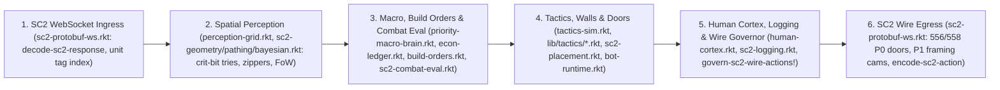

# Mothman SC2 Bot & S2Protocol Sidecar (`#lang sc-bot`)

**Mothman SC2 Bot** (`sticklane/mothman-sc2-bot`) is a pure-Racket StarCraft II ladder bot suite built on `#lang sc-bot`, paired with a high-performance Rust **`s2protocol-sidecar`** (`crates/s2protocol-sidecar/`) for live `.SC2Replay` telemetry, minimap playback, and AI Arena diagnostics.

---

## Architecture Overview

### 1. `#lang sc-bot` Compiler & Race Bots
- **Language & Syntax (`info.rkt`, `main.rkt`, `compiler/syntax.rkt`)**: Coeffect/capability-graded DSL compiling bot definitions, build orders, and capability checks in pure Racket.
- **Ladder Entrypoints (`bots/`, `ladder/`)** (see [`ARCHITECTURE.md`](ARCHITECTURE.md) for the full 5-layer DAG):
  - Active ladder variants built by [`ladder/build-aiarena-zip.rkt`](ladder/build-aiarena-zip.rkt): **`Mothman-X`** (Random, [`bots/Mothman-R.rkt`](bots/Mothman-R.rkt)), **`Mothman-Z`** (Zerg, [`bots/Mothman-Z.rkt`](bots/Mothman-Z.rkt)), **`Mothman-T`** (Terran, [`bots/Mothman-T.rkt`](bots/Mothman-T.rkt)), and **`Mothman-P`** (Protoss, [`bots/Mothman-P.rkt`](bots/Mothman-P.rkt)), plus [`bots/Mothman.rkt`](bots/Mothman.rkt) re-exporting `Mothman-R.rkt`.

### 2. Core Racket Engine (`lib/`)
- **Typed Domain Foundations, Bayesian Inference & Build Orders (Layers 0–1)**:
  - [`lib/sc2-types.rkt`](lib/sc2-types.rkt), [`lib/sc2-common.rkt`](lib/sc2-common.rkt), [`lib/sc2-game-constants.rkt`](lib/sc2-game-constants.rkt), [`lib/sc2-typed-commands.rkt`](lib/sc2-typed-commands.rkt) — `#lang typed/racket/base` canonical race/matchup/geometry structs, safe coercions, LotV constants, attribute bitmasks & exact weapon/spell/armor/buff damage math (`unit-attribute-mask`, `compute-exact-hit-damage-vs-target`, `spell-valid-for-target-attrs?`), and typed wire witnesses.
  - [`lib/sc2-bayesian.rkt`](lib/sc2-bayesian.rkt) — Typed likelihood-ratio updating, categorical normalization, Hellinger divergence, and FoW diffusion.
  - [`lib/build-orders.rkt`](lib/build-orders.rkt) & `lib/build-orders/*.rkt` — Typed matchup build-order specs (`9` matchups) with replay-mined step `target-sec`, `pro-unit-timing`, and `pro-upgrade-timing` clock targets alongside supply curves and race tech-progression DAGs (`Zerg`, `Terran`, `Protoss`).
  - [`lib/sc2-logging.rkt`](lib/sc2-logging.rkt) — Typed structured `[SCBOT_STATE]` mind/goal/tactics step snapshots (`should-emit-step-log?`, `format-bot-step-log-line`).
- **Macro, Economy & Combat Evaluation**:
  - [`lib/priority-macro-brain.rkt`](lib/priority-macro-brain.rkt) — Priority/Braun-heap scheduler with facility-slot escrow, saving-for locks, 8-stream resource bank allocation, crisis upgrade/tech deferral (`crisis-defense-tech-defer-active?`), anti-capital-air `Thor` / `terran-ship-weapons-1` (`air fleet >= 4`) scaling, and `creep-self-sustaining?` `'spawn-creep-tumor` scheduling.
  - [`lib/econ-ledger.rkt`](lib/econ-ledger.rkt) — Symbiotic resource reservation, preemption ledger, crisis defender boosting (`CRISIS-DEFENDER-SYMS`), Zerg Queen inject+creep targets (`desired-zerg-queen-count`, `zerg-queen-target`), build-order tactical timing phase plans (`PRO-BO-TACTICAL-PHASE-PLANS`, `evaluate-build-order-tactical-plan`), opponent opportunity-cost counter overrides & non-counter suppression (`evaluate-opponent-opportunity-cost-commitment`), loss-recovery macro modes (`evaluate-loss-recovery-macro-mode`), worker saturation, and late-game supply management.
  - [`lib/sc2-combat-eval.rkt`](lib/sc2-combat-eval.rkt) & [`lib/mirror-mind-predictor.rkt`](lib/mirror-mind-predictor.rkt) — `#lang typed/racket/base` Lanchester snowball evaluation (`1.7` exponent), personality doctrines, counter trees, double-reaction mastermind loop, FAP combat simulation, attribute/buff engagement predictor (`predict-engagement-outcome`), and $k$-level opponent modeling.
- **Spatial Stack, Tactical Submodules & Door Management (Layers 1–4)**:
  - [`lib/sc2-geometry.rkt`](lib/sc2-geometry.rkt), [`lib/sc2-pathing.rkt`](lib/sc2-pathing.rkt), [`lib/sc2-placement.rkt`](lib/sc2-placement.rkt) — Typed 2D primitives & footprint overlaps, Huet choke zippers, BFS/flow fields & flanking arcs, plus Baba CSP/terrain-grid ramp wall solvers (`solve-terran-ramp-wall`, `solve-protoss-matchup-wall` including `2x 3x3` + `1x1` doorway natural wall-ins with `'slot-3 #f`), multi-base mineral-line & critical-infra static defense placement (`solve-pro-simcity-layout-placement`), and uncamped expansion selection.
  - [`lib/perception-grid.rkt`](lib/perception-grid.rkt) — Pure `#lang typed/racket/base` spatial/temporal memory: Morton 2D crit-bit tries, Hinze-Paterson 2–3 combat finger trees (`split-by-dps`), choke zippers, threat Braun PQ, SBRL frame history, and FoW sector diffusion.
  - [`lib/tactics-sim.rkt`](lib/tactics-sim.rkt) & `lib/tactics/*.rkt` — Facade unifying geometry, pathing, placement, combat evaluation, and 14 tactical submodules including: [`lib/tactics/order-ledger.rkt`](lib/tactics/order-ledger.rkt), [`lib/tactics/arena-minimax.rkt`](lib/tactics/arena-minimax.rkt) (wiring splash disposition, Lanchester ratio, and observed enemy upgrades), [`lib/tactics/zerg-burrow-micro.rkt`](lib/tactics/zerg-burrow-micro.rkt) (`[TR]`, burrow micro + `disruptor-nova-catchable-range`, `should-commit-through-splash?`, and pro-replay `plan-avoid-siege-tank-and-lurker-splash-zones`), [`lib/tactics/stealth-shimmer-response.rkt`](lib/tactics/stealth-shimmer-response.rkt) (`[TR]`), [`lib/tactics/terran-addon-swap.rkt`](lib/tactics/terran-addon-swap.rkt), [`lib/tactics/disruptor-micro.rkt`](lib/tactics/disruptor-micro.rkt) (`[TR]`, re-exported speed catchable range + `cooldown-dive-ok?`), [`lib/tactics/pro-spellcaster-micro.rkt`](lib/tactics/pro-spellcaster-micro.rkt) (`[TR]`, `#115` pro-corpus spellcaster & `Δf = 0` claim micro), [`lib/tactics/unit-mode-micro.rkt`](lib/tactics/unit-mode-micro.rkt) (`[TR]`, Thor/Hellbat/Viking mode hysteresis, Cyclone tether, Marauder Concussive spread), [`lib/tactics/transport-drop-micro.rkt`](lib/tactics/transport-drop-micro.rkt) (`[TR]`, Medivac/WarpPrism/Dropperlord save-pickup, moving self-drop & phasing), [`lib/tactics/multitask-harass-and-proxy.rkt`](lib/tactics/multitask-harass-and-proxy.rkt) (`[TR]`, proxy/runby/harass + `plan-baneling-move-past-and-light-clump-detonate` hold-off, move-past & exact-lethal cap), `creep-and-changeling-tactics.rkt`, `wall-and-block-tactics.rkt`, `map-elements-and-experiments.rkt`, and `static-defense-and-nydus-tactics.rkt`.
  - [`lib/bot-runtime.rkt`](lib/bot-runtime.rkt) — 5-layer live step loop (`step-live-bot-runtime!`), cached engagement-outcome attack gating (`l34-eval-combat-prediction!` suppressing open-field attacks/`bo-rally-override?` into `'kite` while permitting `<= 14.0`-tile TownHall home defense), crisis defense tech deferral (`crisis-tech-upgrade-deferral?`), live AI Arena guards (`[REG-1]` 16-Hatch & proxy-natural protection, `[BUG-2]` active morph protection & siege-counter cap, `[BUG-3]` TownHall worker-rush defense, `[BUG-4]` Protoss `Tempest`/`VoidRay` & Terran multi-`Starport`/`Viking`/`Thor` capital-air response, `[BUG-5]` Terran breakout CCs + `GhostAcademy` vs Queen/Infestor & interior Protoss Pylon placement), `VikingFighter` anti-Stalker tether, far-mineral-patch non-carrying scout worker selection (`select-far-mineral-patch-non-carrying-worker`), dedicated creeping Queens + creep spread, Wave 3 stateful trackers (`rt-disruptor-tracker`, `rt-spell-claims`, `rt-unit-mode-tracker`, `rt-transport-tracker`, `rt-splash-state` with frame-rewind `reset-wave3-tactical-state!`), `[SCBOT_STATE]` structured telemetry emission, Protoss `HoldPosition` wall door-guard state machine (`open`/`closed` transit & trapped-unit unstick), and Terran Supply Depot front-door state tracking & unstick pathing.
- **Human-Cortex Camera Framing & APM Discipline**:
  - [`lib/human-cortex.rkt`](lib/human-cortex.rkt) — Fitts' law saccades, viewport gating (`action-requires-camera-focus`), control-group recall safety, and selection compiler (`compile-optimal-unit-selection!`).
- **Pure-Racket SC2 Protobuf WebSocket Wire Layer**:
  - [`lib/sc2-protobuf-ws.rkt`](lib/sc2-protobuf-ws.rkt), [`lib/sc2-typed-commands.rkt`](lib/sc2-typed-commands.rkt), [`lib/sc2-proto-wire-verifier.rkt`](lib/sc2-proto-wire-verifier.rkt), [`lib/sc2-common.rkt`](lib/sc2-common.rkt), [`lib/sc2-game-constants.rkt`](lib/sc2-game-constants.rkt) — Direct s2clientprotocol Protobuf/RFC 6455 WebSocket actuator (including `RequestDebug` builders `encode-request-debug` / `encode-debug-create-unit` / `encode-debug-kill-unit` / `encode-debug-test-process`, `[BUG-2]` `morph`/`used-producer-tags` exclusion, and `[NOTE-R4-C]` TownHall stack `ATTACK 23` guard), initial `4x2+4x1` worker split (`compute-initial-worker-split-commands`), offline TownHall detector (`townhall-offline?`), far-patch non-carrying wire builder/scout pickers (`worker-carrying-cargo?`, `pick-worker-near`, `pick-far-patch-scout-worker`), Terran depot `556`/`558` P0 raise/lower hysteresis with footprint/transit guards, moving self-drop unloads (`396`/`913`/`1408` targeting own `UnitTag`), `archon` (`1766`) & `overlord-transport` (`2708`) morphs, un-control-grouped camera framing (`Tier 1`, `6`-loop large-jump cooldown), and rolling-window APM wire governor (`govern-sc2-wire-actions!`).
- **Replay Forensics & Verification**:
  - [`lib/sc2-mpq-replay-parser.rkt`](lib/sc2-mpq-replay-parser.rkt), [`lib/state-machine-verifier.rkt`](lib/state-machine-verifier.rkt), [`lib/bot-crash-fuzzer.rkt`](lib/bot-crash-fuzzer.rkt), [`lib/pro-replay-starvation-audit.rkt`](lib/pro-replay-starvation-audit.rkt), [`lib/sc2-unit-tester-lotv.rkt`](lib/sc2-unit-tester-lotv.rkt) (`22.4` Hz offline LotV unit tester verifying `19/19` asymmetric micro scenarios against naive `'default-ai`).

### 3. Rust `s2protocol-sidecar` (`crates/s2protocol-sidecar/`)
Live HTTP/SSE server (`http://127.0.0.1:4322/`) and CLI analyzer powered by `s2protocol = "5.1.0"`:
- **Interactive Telemetry UI ([`crates/s2protocol-sidecar/sidecar-ui.html`](crates/s2protocol-sidecar/sidecar-ui.html))**:
  - HiDPI canvas minimap with cached static terrain/heatmap layers, camera viewport overlays (`P1 CAM`/`P2 CAM`, `cameras: true` by default), raised vs. lowered `SupplyDepot` indicators, combat vectors, win-probability timeline, and filter/search catalog controls.
  - **Native SC2 Observer Leader Panel** synced frame-by-frame during playback with dropdown/pills & keyboard hotkeys:
    - **`D`** Production (constructing buildings, Warp Gate warp-ins, training/morphing units, research progress bars)
    - **`U`** Active Units (workers + combat supply grouped by unit type)
    - **`G`** Upgrades & Research (completed upgrades, `+1/+2/+3` levels, active research)
    - **`V`** APM / EPM (rolling 22s current APM, average APM, average EPM)
    - **`L`** Units Lost (cumulative losses by type and mineral/vespene cost)
    - **`N`** Collapse Leader Panel
- **Server & CLI Modes ([`crates/s2protocol-sidecar/src/main.rs`](crates/s2protocol-sidecar/src/main.rs))**:
  - Endpoints: `GET /`, `GET /api/status`, `GET /api/catalog`, `GET /api/replay/<id>`, `POST /api/analyze-bytes`, `GET /api/events` (SSE).
  - CLI modes: `--serve --port 4322`, `--analyze <file.SC2Replay>`, `--batch-dir <dir>`, `--export-ui-bundle <out.json>`.

---

## How the Bot Works: 5-Layer Per-Step Runtime Pipeline

On every StarCraft II game step (driven natively by [`sim/racket-sc2-ladder-main.rkt`](sim/racket-sc2-ladder-main.rkt)), observations flow from Blizzard's Protobuf WebSocket API through the 5-layer Racket cognitive pipeline (`step-live-bot-runtime!`) and back out through the priority-tiered wire governor:



1. **Wire Ingress & Tactical Translation (`lib/sc2-protobuf-ws.rkt`)**:
   - `decode-sc2-response` unpacks raw protobuf `ResponseObservation` frames (game loop, units, orders, upgrades, power sources, active camera position, dead tags) into `sc2-observation`, while `sc2-observation->runtime-obs-hash` normalizes worker/facility counts, live unit-tag lookups, and base anchors for the runtime layers.
   - On egress, `translate-bot-actions->sc2-raw-commands` validates typed actions against live unit tags, evaluates Terran Supply Depot auto-raise (`558`) and auto-lower (`556`) hysteresis (`<= 14.0`/`16.0` raise vs. `> 15.0`/`17.0` clear lower) guarded by `friendly-unit-on-depot-footprint?` and `friendly-unit-requesting-depot-transit?` with both promoted to `P0` in `wire-cmd-priority-tier`, and tracks `SC2-CONTROL-GROUPED-TAGS` (`0–7`) so commands targeting un-control-grouped units outside the viewport prepend a `Tier 1` framing `sc2-raw-camera-move`.
2. **Spatial Perception, Pathing & Bayesian FoW (`lib/perception-grid.rkt`, `lib/sc2-geometry.rkt`, `lib/sc2-pathing.rkt`, `lib/sc2-bayesian.rkt`)**:
   - `step-layer1-perception!` ingests allied and enemy unit snapshots via `perception-grid-ingest-frame!` into Morton 2D Z-order crit-bit spatial tries (`perception-grid-query-box`), 2–3 monoidal combat finger trees (`split-by-dps`), and persistent skew-binary frame histories.
   - `lakefill-choke-decomposition` and `huet-zipper` (`lib/sc2-pathing.rkt`) model base/natural/third ramp chokes with $O(1)$ rollback, while `fow-ghost-step-diffusion!` (`lib/sc2-bayesian.rkt`) and `best-retreat-sector` track sector threat weights and FoW persistence.
3. **Priority Macro, Build Orders, Combat Eval & Escrow Economy (`lib/priority-macro-brain.rkt`, `lib/econ-ledger.rkt`, `lib/build-orders.rkt`, `lib/sc2-combat-eval.rkt`)**:
   - `step-layer1b-mastermind!`, `step-layer1c-mirror-mind!`, and `step-layer2-economy!` evaluate double-reaction counter trees (`step-double-reaction!` in `sc2-combat-eval.rkt`), mirror predictions (`mirror-mind-predictor.rkt`), and typed matchup specs (`lib/build-orders/*.rkt`, combining supply gating with replay-mined `pro-unit-timing`, `pro-upgrade-timing`, step `target-sec` clock schedules, Zerg `'creeping-queen` / `'creep-tumor` goals, and `PRO-BO-TACTICAL-PHASE-PLANS` timing-attack dispositions via `evaluate-build-order-tactical-plan`), then build a decoupled `macro-world-state` via `obs-hash->macro-world-state` and run `step-priority-macro-brain` over `SC2-TECH-GRAPH` (checking prerequisites via `resolve-missing-prereq-chain`, scheduling `'spawn-creep-tumor` until `creep-self-sustaining?`).
   - Pointerless Braun priority queues (`braun-insert`) rank competing spending goals alongside symbiotic escrow reservations (`make-symbiotic-ledger`, `ledger-reserve!`, `ledger-preempt-for-crisis!`) and `macro-brain-can-spend?` locks, while `evaluate-coupled-macro-governor` balances expansion timing, worker saturation (`22`/base), far-patch non-carrying scout selection (`select-far-mineral-patch-non-carrying-worker`), and multi-stream mineral/gas/supply budgets.
4. **Tactics, Ramp Walling & Front-Door Guards (`lib/tactics-sim.rkt`, `lib/tactics/*.rkt`, `lib/sc2-placement.rkt`, `lib/bot-runtime.rkt`)**:
   - `step-layer3-and-4-tactics!` runs Baba CSP and terrain-grid wall solvers (`solve-terran-ramp-wall`, `solve-protoss-matchup-wall` with `2x 3x3` + `1x1` doorway natural walls `'slot-3 #f` in `lib/sc2-placement.rkt`) verified against ramp pathing/placement/height grids, `fap-posture-with-hysteresis` & `purplewave-traffic-retreat` (`lib/sc2-combat-eval.rkt`), pro-replay (`1,798` replays) splash commit vs standoff (`should-commit-through-splash?`, speed-aware `disruptor-nova-catchable-range`, `cooldown-dive-ok?`, ETL/base Colossus radial split dive, and Tank/Lurker/Storm run-through-splash concaves across `zerg-burrow-micro.rkt`, `disruptor-micro.rkt`, `arena-minimax.rkt`, and `bot-runtime.rkt`), and modular micro engines under `lib/tactics/` (`order-ledger.rkt`, `arena-minimax.rkt`, `zerg-burrow-micro.rkt`, `stealth-shimmer-response.rkt`, `terran-addon-swap.rkt`, `disruptor-micro.rkt`, `pro-spellcaster-micro.rkt`, `unit-mode-micro.rkt`, `transport-drop-micro.rkt`, `multitask-harass-and-proxy.rkt` incl. `plan-baneling-move-past-and-light-clump-detonate`) — including `#115` pro-corpus calibrations (`31`-frame Disruptor stagger, `34`-frame Ghost Snipe lockout, `60`-frame Oracle Pulsar Beam dwell, `140`/`208`-frame Warp Prism phasing, `224`-frame Thor & `176`-frame Hellbat mode dwells, `32`-frame Marauder Concussive spread, `672`-frame stuck-cargo rescue, and moving self-drop unloads).
   - Protoss `HoldPosition` doorway micro (`rt-door-state`: `'open`/`'closed`) parts its Zealot/Stalker wall guard for transiting workers or `>= 1` trapped combat unit when enemies are `> 6.5` tiles away, nudges idle trapped units across the opening, and re-seals immediately; Terran doorway tracking (`rt-door-state`) monitors `supply-depot`/`supply-depot-lowered` transitions and emits unstick `move` pathing after `>= 2` trapped frames.
5. **Human-Cortex Framing, Structured Telemetry & Wire APM Governor (`lib/human-cortex.rkt`, `lib/sc2-logging.rkt`, `govern-sc2-wire-actions!`)**:
   - `step-layer5-human-cortex!` models human attention with `fitts-saccade-ms` camera fixations and `in-camera-viewport?` gating: `action-requires-camera-focus` emits `(move-camera fx fy)` immediately before spatial builds or un-control-grouped unit commands outside the current viewport, while `compile-optimal-unit-selection!` only recalls a control group when all desired unit IDs belong to it.
   - `step-live-bot-runtime!` attaches structured `'state-log` snapshots (`lib/sc2-logging.rkt`) on every step and emits `[SCBOT_STATE]` telemetry lines via `should-emit-step-log?` (`sim/racket-sc2-ladder-main.rkt`), while `govern-sc2-wire-actions!` enforces the rolling 60-second replay APM/token cap (`target-apm`/`hard-cap-apm`), preserves `P0` depot/survival actions and `Tier 1` camera-before-command ordering, and transmits wire bytes via `encode-sc2-action`.

---

## Pure-Racket Tooling Policy (`AGENTS.md`)

All bot logic, MPQ/`.SC2Replay` analysis, AI Arena API tools, and test scripts in this repository follow a **strict 100% Pure-Racket policy** (no `python3` or new `*.py` scripts for analysis or tooling). Canonical CLI tools live in [`tools/`](tools/):
- [`tools/aiarena-api-client.rkt`](tools/aiarena-api-client.rkt) — AI Arena BotZip sync, match requests, and status polling
- [`tools/analyze-aiarena-replays.rkt`](tools/analyze-aiarena-replays.rkt) — AI Arena replay & match telemetry forensics (canonical 9-matchup `ZvZ`–`PvP` & rolled-race summaries, `--matchup`, `--by-build-order`, `--by-opponent-strategy`)
- [`tools/run-lotv-unit-tester.rkt`](tools/run-lotv-unit-tester.rkt) — Offline SC2 LotV Unit Tester CLI (`--all`, `--scenario <id>`, `--json`, `--verify`, `--list`)
- [`tools/run-real-sc2-bot-match.rkt`](tools/run-real-sc2-bot-match.rkt) — Headless `SC2_x64` match harness
- [`tools/audit-pro-replay-starvation.rkt`](tools/audit-pro-replay-starvation.rkt) & [`tools/racket-multi-match-validator.rkt`](tools/racket-multi-match-validator.rkt) — Starvation & multi-match validation
- [`tools/fuzz-sc2-protobuf-output.rkt`](tools/fuzz-sc2-protobuf-output.rkt) — Protobuf differential schema fuzzer

Default test execution in [`tests/run-all-tests.rkt`](tests/run-all-tests.rkt) (Suites `1.1–49`, `2,210` assertions; alongside `331` checks in [`tests/sc2-protobuf-ws-test.rkt`](tests/sc2-protobuf-ws-test.rkt) and `273` assertions in [`tests/typed-commands-test.rkt`](tests/typed-commands-test.rkt)) is kept strictly under `< 5,000 ms` (`FAST-<5s` mode; compile first with `raco make -j 4`).

---

## Build & Test Commands

```bash
# 1. Compile and run the full #lang sc-bot verification suite (< 5s fast mode)
raco make -j 4 tests/run-all-tests.rkt && racket -y tests/run-all-tests.rkt

# 2. Run the offline SC2 LotV Asymmetric Micro Unit Tester (19 scenarios)
raco make -j 4 tools/run-lotv-unit-tester.rkt && racket -y tools/run-lotv-unit-tester.rkt --all --verify

# 3. Run the pure-Racket Protobuf + RFC 6455 WebSocket suite
raco make -j 4 tests/sc2-protobuf-ws-test.rkt && racket -y tests/sc2-protobuf-ws-test.rkt

# 4. Run the Rust s2protocol-sidecar test suite
cargo test --manifest-path crates/s2protocol-sidecar/Cargo.toml

# 5. Run the live sidecar daemon at http://127.0.0.1:4322/
cargo run --release --manifest-path crates/s2protocol-sidecar/Cargo.toml -- --serve --port 4322
```
