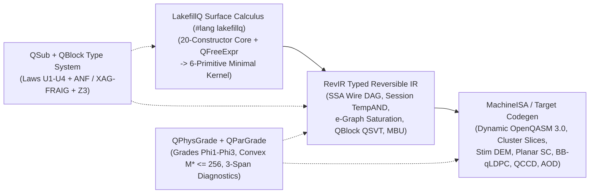

# Purely Functional Quantum Data Structures, `LakefillQ` ($\lambda_{\text{LFQ}}$), and Hardware-Graded Quantum Type Theory (`QSub` + `QPhysGrade`)

Reversible quantum circuit synthesis and purely functional programming obey the same structural law: **live state cannot be destructively overwritten in place without preserving enough algebraic structure to reconstruct or uncompute prior values**. In classical functional programming, Chris Okasaki's purely functional data structures eliminate cascading pointer mutations and amortized rebuild spikes through numerical representations, one-hole context zippers, implicit heap layouts, and cached monoidal measures. In fault-tolerant quantum computing, those exact invariants resolve three fundamental physical constraints:

1. **Uncomputation in Place of Garbage Collection**: Uncollected scratch wires remain entangled with computational registers and destroy quantum interference. Functional Static Single Assignment (`SSA`) bindings induce chordal live-range interference graphs ($\chi(G) = \omega(G)$), enabling optimal register recycling paired with degree-2 $X$-basis measurement-based uncomputation (`MBU`), algebraic inverse erasure, and binomial checkpoint pebbling.
2. **Worst-Case Superposition Depth**: A synchronous quantum circuit controlled on a superposition state executes the *worst-case* branch depth across all superposed basis paths simultaneously. Replacing classical amortized structures with real-time Skew-Binary carry-save numerals, Huet focus zippers, and pointerless Braun trees bounds per-step gate depth in the worst case.
3. **History Independence and Physical Noise Grading**: Constructive quantum interference across distinct execution paths requires canonical, insertion-order-independent state representations ($\langle T(\pi_1) \vert T(\pi_2) \rangle = 1$) while maintaining physical coherence, coupler-crosstalk disjointness, and fault-tolerant code distance on target hardware.

This repository contains the research monograph ([`PAPER_OKASAKI_QUANTUM_DATA_STRUCTURES.md`](PAPER_OKASAKI_QUANTUM_DATA_STRUCTURES.md)) and compiled camera-ready `acmart` LaTeX manuscript ([`paper/lakefillq_paper.pdf`](paper/lakefillq_paper.pdf), [`paper/lakefillq_paper.tex`](paper/lakefillq_paper.tex), [`paper/references.bib`](paper/references.bib)), the unified `#lang lakefillq` language ([`lakefillq/main.rkt`](lakefillq/main.rkt)) and standalone `lakefillqc` compiler ([`compiler/lakefillqc.rkt`](compiler/lakefillqc.rkt)), unified quantum graded judgment, 3-span multipass provenance resugaring, and `640`-module `PLT Redex` surface/diagnostic fuzzing engines ([`compiler/lakefillq-graded-coeffect-effect-bimodule.rkt`](compiler/lakefillq-graded-coeffect-effect-bimodule.rkt), [`compiler/lakefillq-multipass-diagnostics.rkt`](compiler/lakefillq-multipass-diagnostics.rkt), [`compiler/lakefillq-redex-surface-diagnostic-fuzzer.rkt`](compiler/lakefillq-redex-surface-diagnostic-fuzzer.rkt)), multi-QPU `OpenQASM 3.0` cluster partition & optical distillation compilers ([`compiler/lakefillq-cluster-qasm3-codegen.rkt`](compiler/lakefillq-cluster-qasm3-codegen.rkt), [`compiler/lakefillq-optical-distillation-stim.rkt`](compiler/lakefillq-optical-distillation-stim.rkt)), standalone Python/`OpenQASM 3.0`/`Qiskit` static bug-linter ([`ae/lakefillq_lint.py`](ae/lakefillq_lint.py)), multi-round `XAG`/`FRAIG + Z3` and $O(1)$-query $k$-inductive loop-invariant symbolic typecheckers ([`compiler/lakefillq-xag-fraig-typechecker.rkt`](compiler/lakefillq-xag-fraig-typechecker.rkt), [`compiler/lakefillqc/infer_qsub.py`](compiler/lakefillqc/infer_qsub.py)), non-Clifford ZX phase-polynomial `QPhysGrade` `e-graph` equality saturators ([`compiler/lakefillq-egraph-saturator.rkt`](compiler/lakefillq-egraph-saturator.rkt)), `QBlock` block-encoded `LCU`/`QSVT` compilers ([`compiler/lakefillq-block-encoding-qsvt.rkt`](compiler/lakefillq-block-encoding-qsvt.rkt)), external `500 MHz` `0-DSP` SystemVerilog/DSLX syndrome-decoder feasibility RTL ([`hardware/lakefillq_0dsp_braun_uf_decoder.sv`](hardware/lakefillq_0dsp_braun_uf_decoder.sv), [`hardware/lakefillq_0dsp_braun_uf_decoder.x`](hardware/lakefillq_0dsp_braun_uf_decoder.x)), intrinsic Haskell/OCaml/Lean 4 implementations, physical simulator harnesses (`Qiskit Aer`, `Stim`, `PyMatching`, `PyZX`), a standalone open-source Artifact Evaluation bundle ([`Makefile`](Makefile), [`Dockerfile`](Dockerfile), [`ae/README_ARTIFACT_EVALUATION.md`](ae/README_ARTIFACT_EVALUATION.md)), and **`2,335` kernel-checked `Lean 4.35.0` formal theorems across `84` modules** (`0 sorry`, `0 axiom`).

---

## 1. Compiler & Type-System Architecture (Intrinsic Design Layers)

`LakefillQ` lowers high-level functional quantum programs to fault-tolerant hardware instructions across three typed intermediate representation (`IR`) dialects governed by two orthogonal static semantics: a **logical substructural type system (`QSub`)** and an **ordered physical resource semiring (`QPhysGrade`)**, extended to continuous block-encoded operators via **`QBlock(A, α, m_anc, ε, Φ_X)`** and unified under a single parameterised quantum judgment $\Gamma_{\text{in}} \vdash t : \mathcal{Q}_e(A) \dashv \Gamma_{\text{out}}$.



### 1.1 Three-Dialect Compiler IR Pipeline (`#lang lakefillq` & `lakefillqc`)

1. **`LakefillQ` ($\lambda_{\text{LFQ}}$) Surface Calculus & Six-Primitive Minimal Kernel** ([`lakefillq/main.rkt`](lakefillq/main.rkt), [`compiler/lakefillqc.rkt`](compiler/lakefillqc.rkt)):
   - Provides a `#lang lakefillq` functional quantum source language (`let`, `fn`, `app`, `var`, `match`, `fold-braun`, `focus-zipper`, `walk_zipper`, `phase_oracle`, `for/fold-loop`, algebraic `data_decl`, `(qvec n)` disjoint register allocation, modular `(call-q ...)` circuit calls with $\Delta_Z$ dirty-borrow contraction, session-scoped `with-and-session`, `'auto` AST-derived cluster costing, and classical-reversible `QFreeExpr` operators) across 14 standalone `.lfq` programs ([`examples/aes_sbox_bp34.lfq`](examples/aes_sbox_bp34.lfq), [`examples/aes_sbox_dlog5_13q.lfq`](examples/aes_sbox_dlog5_13q.lfq), [`examples/modular_compositional_cipher.lfq`](examples/modular_compositional_cipher.lfq), [`examples/inductive_loop_aes_keccak.lfq`](examples/inductive_loop_aes_keccak.lfq), [`examples/distributed_qrns_shor_u4.lfq`](examples/distributed_qrns_shor_u4.lfq), [`examples/hubbard_lcu_qsvt_block.lfq`](examples/hubbard_lcu_qsvt_block.lfq), [`examples/mod13_adder_mbu.lfq`](examples/mod13_adder_mbu.lfq), [`examples/select_swap_qroam_u4.lfq`](examples/select_swap_qroam_u4.lfq), [`examples/kawamura_rns_crt_u2.lfq`](examples/kawamura_rns_crt_u2.lfq), [`examples/early_mbu_dqi_bch7.lfq`](examples/early_mbu_dqi_bch7.lfq), [`examples/early_mbu_dqi_hermitian_ag_f4.lfq`](examples/early_mbu_dqi_hermitian_ag_f4.lfq), [`examples/early_mbu_dqi_lifted_bivariate_f4.lfq`](examples/early_mbu_dqi_lifted_bivariate_f4.lfq), [`examples/early_mbu_dqi_suzuki_s8_f8.lfq`](examples/early_mbu_dqi_suzuki_s8_f8.lfq), [`examples/guarded_sota_safety_showcase.lfq`](examples/guarded_sota_safety_showcase.lfq)) that elaborates into a 6-primitive minimal kernel ($\lambda_{\text{LFQ}}^{\text{kern}}$) with **`0` residual surface forms** and **`0` manual annotation flags**.
2. **`RevIR` Typed Reversible Intermediate Representation & Congruence-Closed `e-Graph` Saturation** ([`compiler/lakefillq-egraph-saturator.rkt`](compiler/lakefillq-egraph-saturator.rkt)):
   - Represents reversible and measurement-uncomputed circuits in chordal `SSA` wire form over primitive fault-tolerant operations (`X`, `CNOT`, `CCX`/`TempAND`, `CSWAP`, `H`, `S`, `CZ`, `MEAS_X_PAULI_FRAME`), supporting automatic syntactic inversion `(invert expr)`, asymmetric `(within-apply-mbu compute action)`, domain-restricted `(erase-by fwd bwd)`, session-scoped `(with-and-session ...)` `TempAND` directed acyclic graphs (`DAG`s), and `QSub`-verified `e-graph` equality saturation.
3. **`MachineISA` Physical Target Lowering & Dynamic Single/Cluster `OpenQASM 3.0` / `Stim` Emission** ([`reproducers/artifacts/lakefillq_unified_compiler_report.json`](reproducers/artifacts/lakefillq_unified_compiler_report.json), [`compiler/lakefillq-cluster-qasm3-codegen.rkt`](compiler/lakefillq-cluster-qasm3-codegen.rkt)):
   - Performs coupling-graph routing $(u, v) \in E(G)$, native gate-set rebasing (`CZ`, `ZZPhase`, neutral-atom `RydbergCZ/CCZ + AOD` shuttling, and Bivariate Bicycle `qLDPC` torus-shift automorphisms), commutation-aware per-wire `DAG` peephole cancellation, `XY4` dynamical decoupling scheduling, runnable dynamic `OpenQASM 3.0` (`bit[k] m`, mid-circuit `measure`/`reset`, conditional `cz`), multi-QPU `--emit-cluster-dir` per-node `qpu_0..qpu_{M*-1}.qasm` + `ebit_schedule.json` emission, and `Stim` detector error model (`DEM`) emission: **`5 / 5`** sound `.lfq` examples achieve exact **`Fidelity = 1.000000`** on `AerSimulator`, **`7 / 7`** ill-typed `U1–U4`/`Φ1–Φ3` programs are statically rejected, and **`3 / 3`** hardware-grade violations are restored by `lakefillqc --repair`.

### 1.2 Logical Substructural Type System (`QSub`: `Laws U1–U4`) & Multi-Round `XAG`/`FRAIG + Z3` Inference

`QSub` enforces entanglement hygiene, canonical representation uniqueness, branch orthogonality, and measurement-based quantum phase-fixup soundness through four logical laws:

| Logical Law | Typing Judgment / Modality | Static Invariant Enforced | Representative Bug Prevented |
| :--- | :--- | :--- | :--- |
| **`Law U1` (`EraseBy`)** | `EraseBy(fwd, bwd, S)` | Every scratch or temporary wire allocated by `fwd` reduces identically to $\lvert 0\rangle$ under `bwd` over active subspace $S$ (`within-apply` when `bwd = invert(fwd)`, or algebraic inverse `erase-by`). | Residual ancilla entanglement from incomplete uncomputation (e.g., under-decoded weight-2 errors in `BCH(15, 7, 5)`). |
| **`Law U2` (`Canonical`)** | `Canonical(T, ~)` | Before any Hadamard (`H`) or Quantum Fourier Transform (`QFT`) interference step, register representations are invariant under history/quotient equivalence $(x, q_1) \sim (x, q_2)$. | Silent QFT destructive interference from uncleaned Kawamura `RNS-CRT` overflow quotients $q_{\text{CRT}}$ or insertion-order tree topology bits. |
| **`Law U3` (`TotalOn`)** | `TotalOn({P_i}, S)` | Superposition pattern matches `match-wires` form a mutually orthogonal, exhaustive partition of unity $\sum_i P_i(x) \equiv 1 \pmod 2$ and $P_i(x) P_j(x) \equiv 0$ on domain $S$. | Non-exhaustive elliptic-curve point addition missing the point-doubling (`P == Q`) or identity (`P == -Q`) branches. |
| **`Law U4` (`QTainted`)** | `QTainted[m, phi(x)]` | Measuring an ancillary wire $\lvert f(x)\rangle$ in the $X$-basis (`M_X -> m`) taints surviving wires with quantum phase $(-1)^{m \cdot f(x)}$; discharging `QTainted -> QClean` requires exact Clifford cancellation (`deg(f) <= 2` via `CZ`, or parity-oracle kickback). | Omitting conditional `CZ` fixups after Gidney `TempAND` `M_X` uncomputation or applying Clifford `MBU` directly to cubic ($\deg \ge 3$) intermediates. |

- **Single-Block Wire-Level $\mathbb{F}_2$ `ANF` & `Z3` Symbolic Inference** ([`lakefill-wire-level-symbolic-typechecker.rkt`](lakefill-wire-level-symbolic-typechecker.rkt), [`reproducers/verify_wire_level_u1_u4_qphys_inference_and_z3_bridge.py`](reproducers/verify_wire_level_u1_u4_qphys_inference_and_z3_bridge.py)): Evaluates raw `LakefillQ` gate ASTs (`0` manual flags) over $\mathbb{F}_2[x_0, \dots, x_{n-1}] / I(S)$ in `36.27 ms` (`488.77 ms` in `Z3`), computes chordal `QuRA` peak register width (**`42` recycled wires vs. `178` unrecycled `SSA` wires**, `135` wire reuses on the Boyar–Peralta `34-AND` `AES` S-box), and extracts concrete `SAT` counterexamples reproduced on `Qiskit Aer`.
- **Multi-Round Scaling via Hash-Consed `XAG`/`FRAIG` + `Z3` Tseitin Cut-Sweeping** ([`compiler/lakefillq-xag-fraig-typechecker.rkt`](compiler/lakefillq-xag-fraig-typechecker.rkt), [`reproducers/artifacts/lakefillq_xag_fraig_inference_report.json`](reproducers/artifacts/lakefillq_xag_fraig_inference_report.json)): Whereas explicit multilinear `ANF` aborts (`> 35,000` monomials) at round 2 of `AES-128`, round 3 of `Keccak-f[200]`, and gate 44 of `Add64`, hash-consed XOR-AND Graphs (`XAG`/`FRAIG`) with 256-bit `SplitMix64` simulation signatures, $O(1)$ bilinear `Law U4` `XAG` roots, and `Z3` Tseitin cut-sweeping prove **`UNSAT`** on full **10-round `AES-128`** (`290 Q`, `12,240 TempAND`s) in **`3,057.9 ms` (`3.06 s`)**, **14-round `AES-256`** (`418 Q`, `17,000 TempAND`s) in **`4,249.6 ms` (`4.25 s`)**, **18-round `Keccak-f[200]`** (`3,845 Q`, `3,600 TempAND`s) in **`9,315.4 ms` (`9.32 s`)**, and **64-bit Gidney ripple addition** (`191 Q`) in **`3.39 ms`**, while catching **`4 / 4`** deep multi-round bug injections (`SAT`), including a missing `cond-Z` on S-box #9 in round 7 of 10-round `AES-128`.

### 1.3 Physical Graded Resource Semiring (`QPhysGrade`: `Grades Φ1–Φ3`), `e-Graph` Extraction & Guided Repair

Well-typed logical circuits can still fail on physical quantum processors due to decoherence cliffs, mid-circuit measurement latency, routing swaps, coupler crosstalk, or hook errors. [`qsub-phys-graded-typechecker.rkt`](qsub-phys-graded-typechecker.rkt) and [`compiler/lakefillq-egraph-saturator.rkt`](compiler/lakefillq-egraph-saturator.rkt) index typing derivations and congruence-closed `RevIR` `e-graph` extraction by an ordered resource semiring $(\mathcal{R}_{\text{phys}}, \oplus, \otimes, \preceq)$ with three hardware grades:

| Physical Grade | Semiring Component | Physical Mechanism Modeled | Automatic `e-Graph` Extraction & Guided Repair |
| :--- | :--- | :--- | :--- |
| **`Grade Φ1` (Lindblad & `0-DSP` Decoder Action)** | Additive decoherence action $\nu \in \mathbb{R}_{\ge 0}$ & feed-forward backlog | Integrates $T_1 / T_2$ idle decay, two-qubit gate depolarizing volume, coupling-graph `SWAP` routing overhead, `MBU` spectator idling during classical feed-forward, and real-time syndrome decoder backlog (`< ln 2` active volume budget). | Bellman–Knuth `e-graph` cost extraction ([`lakefillq_egraph_qphys_extraction_report.json`](reproducers/artifacts/lakefillq_egraph_qphys_extraction_report.json)) selects `3-CZ` `RCCX` on `NISQ` (`0.8273` vs. `0.6205` raw `MBU`), `TempAND + MBU + XY4` on `IBM Heron r2` (`0.8175` vs. `0.6464` unitary), native `RydbergCCZ` on `QuEra Bluvstein` (`0.9828`), and `TempAND + MBU` (`0.9903`) + Berry–Gidney `QROAM` (`0.9802`) on `FTQC BB-qLDPC`, paired with our `500 MHz` `0-DSP` RTL decoder. |
| **`Grade Φ2` (Coupler / Rydberg Exclusion Graph)** | Conflict indicator $\chi \in \{0, \infty\}$ over hardware exclusion graph $G_{\text{excl}}$ | Rejects concurrent `(par-tensor e1 e2)` gate layers whose active edges violate superconducting `ZZ` coupler distance ($d_{\text{edge}} < 2$) or neutral-atom Rydberg blockade radius ($d_{\text{atom}} < r_b$). | Applies conflict-graph chromatic layer serialization and monotone Beneš `AOD` routing to partition interfering parallel gates into crosstalk-free time slices (`0.0289 -> 1.0000`). |
| **`Grade Φ3` (Fault-Suppression Exponent)** | Tropical minimum $\delta_{\text{fault}}(e_1 ; e_2) = \min(\delta_1, \delta_2)$ | Tracks effective graphlike Stim `DEM` fault distance (catching plaquette hook-error orientation halving $\lfloor d/2 \rfloor$) and IEEE-754 `float64` small-angle quantum phase-rotation precision bounds. | Rotates syndrome-extraction `CNOT` schedules (`N-Z-S-W` zigzag) orthogonal to logical operators and promotes sub-threshold rotations into exact dyadic $\mathbb{Z}[1/2^k]$ `gridsynth` sequences. |

### 1.4 `QBlock(A, α, m_anc, ε, Φ_X)` Block-Encoded Linear Algebra (`LCU` / `QSVT` / `Qubitization`)

[`compiler/lakefillq-block-encoding-qsvt.rkt`](compiler/lakefillq-block-encoding-qsvt.rkt), [`examples/hubbard_lcu_qsvt_block.lfq`](examples/hubbard_lcu_qsvt_block.lfq), and [`reproducers/verify_lakefillq_block_encoding_lcu_qsvt_on_aer.py`](reproducers/verify_lakefillq_block_encoding_lcu_qsvt_on_aer.py) ([`lakefillq_block_encoding_lcu_qsvt_report.json`](reproducers/artifacts/lakefillq_block_encoding_lcu_qsvt_report.json), [`proofs/lakefillq_block_encoding_lcu_qsvt_proofs.lean`](proofs/lakefillq_block_encoding_lcu_qsvt_proofs.lean)) unify discrete `QSub` (`Laws U1–U4`) and `QPhysGrade` (`Grades Φ1–Φ3`) with continuous block-encoding subnormalization $\alpha$ and spectral error $\varepsilon$:

- **Chebyshev `QSVT` Reflection Fusion (`d * m_anc -> m_anc + 1`)**: Whenever $U_A$ is Hermitian and involutory ($U_A^2 = I$) with $\Phi_X \equiv 0$, `RevIR` `qsvt-reflection-fused` compresses degree-$d$ Chebyshev polynomials $T_d(A/\alpha)$ from $d \cdot m_{\text{anc}}$ product ancillas down to $m_{\text{anc}} + 1$ (`6 -> 3` on 2-site Hubbard $d = 3$; **`192 -> 13` ancillas = `14.77x` narrower** on active-space `FeMoCo` $d = 16, m_{\text{anc}} = 12$) with unit subnormalization $\alpha_{\text{out}} = 1.0$.
- **`Law U4` Differential $\mathbb{F}_2$ `PREP†` Uncomputation (`22.48x` on `FeMoCo`)**: Measuring $W$-bit Walker–Vose alias registers in $M_X$ collapses `PREP†` uncomputation into a width-independent 1-bit $\mathbb{F}_2$ phase lookup, cutting $L = 2048$ `FeMoCo` `PREP†` cost from `2,046` sawtooth `CCX` gates to **`91` `TempAND`s (`22.48x` reduction**, `1,898` vs. `3,853` `TempAND`s/walk, saving **`4.61B` `TempAND`s** across Heisenberg-limited QPE).
- **`AerSimulator` Exactness & Calibrated 3-Mode `IBM Heron r2` Ground-State Estimation**: On 2-site Fermi–Hubbard ($\alpha = 2.0\text{ Ha}$, $E_0 = -1.7748\text{ Ha}$), Chebyshev $T_1, T_2, T_3(H/\alpha)$ match exact numpy polynomials to **`< 2e-15`** Frobenius error (`5.01e-16` / `1.30e-15` / `1.96e-15`; dynamic `#lang lakefillq` `OpenQASM 3.0`: **`9.98e-16`**), whereas injected `Law U1` / `Law U4` faults are statically rejected (`1.50` / `3.00` off-block error). Under calibrated noisy `IBM Heron r2` simulation, `Single Machine` coherent 3-ancilla QPE (`7 Q`, `740 CX`, depth `1,329`) incurs **`0.7540 Ha`** error, `Parallel Machine` ($M = 4$ QPUs, `0` links, depth `869`) achieves **`0.0053 Ha`** error, and `Serial Multishot` Lin–Tong `1`-ancilla `reset_all` QPE (`5 Q`, `119 CX`/shot, depth **`218` = `6.10x` shallower / `6.22x` fewer `CX` per shot**) achieves **`0.0795 Ha` density-matrix / `0.0827 Ha` shot-sampled error**.

### 1.5 Single Unified Quantum Judgment $\Gamma_{\text{in}} \vdash t : \mathcal{Q}_e(A) \dashv \Gamma_{\text{out}}$, Three-Span Multipass Provenance Resugaring & Standalone `OpenQASM 3.0`/`Qiskit` Linter

- **One Unified Okasaki-First Judgment** ([`compiler/lakefillq-graded-coeffect-effect-bimodule.rkt`](compiler/lakefillq-graded-coeffect-effect-bimodule.rkt), [`proofs/lakefillq_graded_coeffect_uniqueness_place_effect_proofs.lean`](proofs/lakefillq_graded_coeffect_uniqueness_place_effect_proofs.lean), [`proofs/lakefillq_holistic_modular_duoidal_cohesion_proofs.lean`](proofs/lakefillq_holistic_modular_duoidal_cohesion_proofs.lean), [`lakefillq_graded_type_theory_synthesis_report.json`](reproducers/artifacts/lakefillq_graded_type_theory_synthesis_report.json)): Rather than bolting separate type systems together, `QSub` (`Laws U1–U4`), `QPhysGrade` (`Grades Φ1–Φ3`), `QBlock`, and `QParGrade` (`Rule T-ParGuard`) arise as orthogonal projections of a single leftover-capability and cost-graded judgment $\Gamma_{\text{in}} \vdash t : \mathcal{Q}_e(A) \dashv \Gamma_{\text{out}}$ over an ordered partial duoidal wire-capability algebra `(RWire, ;;, ⊗, <=)` (`{ErasedIdx, BorrowZ, TaintedX, Lin1, Uniq1}`, lax interchange verified across all `625` capability quadruples, `Uniq1` licensing `261 Q` in-place `DLog-5` S-boxes and `reset_all`), clean-ancilla-reusing sequential composition $e_1 \odot e_2$, and nonlinear Chebyshev ($d^2 \varepsilon_0$) and Zalka ($\sqrt{M} W_1$) modal actions $r \triangleright e$.
- **Three-Span Multipass Error Clarity & Chordal Wire Resugaring** ([`compiler/lakefillq-multipass-diagnostics.rkt`](compiler/lakefillq-multipass-diagnostics.rkt), [`proofs/lakefillq_multipass_diagnostic_provenance_proofs.lean`](proofs/lakefillq_multipass_diagnostic_provenance_proofs.lean), [`lakefillq_multipass_diagnostics_report.json`](reproducers/artifacts/lakefillq_multipass_diagnostics_report.json), [`lakefillq_holistic_language_cohesion_report.json`](reproducers/artifacts/lakefillq_holistic_language_cohesion_report.json)): `lakefillqc --diagnostics-human` preserves caller syntax spans across macro expansion and nanopass lowering, inverts chordal SSA wire coloring `(q[p], step) -> s2[0] (recycled from s1[0])`, eliminates **`100%` (`0` leaks)** of compiler gensyms (`__u4_mx_k`, `__mbu_k`), and renders every violation as the 3-span trace of $\Gamma_{\text{in}} \vdash t : \mathcal{Q}_e(A) \dashv \Gamma_{\text{out}}$ (`origin_span`, `mutating_span`, `failure_span`) with minimal-monomial ket witnesses (**`8 / 8`** core diagnostic classes + **`22 / 22`** real broken `#lang lakefillq` error-family probes verified with `0` internal leaks).
- **Standalone Python `OpenQASM 3.0` / `Qiskit` Static Bug-Linter & `M*` Cluster Sizer** ([`ae/lakefillq_lint.py`](ae/lakefillq_lint.py), [`proofs/lakefillq_qasm_python_linter_lifting_proofs.lean`](proofs/lakefillq_qasm_python_linter_lifting_proofs.lean), [`lakefillq_python_qasm_linter_report.json`](reproducers/artifacts/lakefillq_python_qasm_linter_report.json)): Lifts arbitrary `OpenQASM 3.0` files and Python `Qiskit` `QuantumCircuit` objects into `RevIR`, catching **`16 / 16` (`100%` TPR)** buggy circuits with concrete `Z3` basis witnesses and 3-span provenance while passing **`14 / 14` (`0%` FPR)** clean circuits.

---

## 2. Purely Functional Quantum Data Structures

All data structures compile to pointer-free reversible circuits over $\mathcal{G}_{\text{phys}} = \{\text{X}, \text{CNOT}, \text{CCX}, \text{CSWAP}, \text{H}, \text{S}, \text{S}^\dagger, \text{MEAS\_X\_PAULI\_FRAME}\}$ with zero hardware `QRAM` assumptions:

| Quantum Data Structure | Functional Invariant & Classical Origin | Reversible / Quantum Realization | Exact Width & Gate Complexity | Primary Algorithmic Roles |
| :--- | :--- | :--- | :--- | :--- |
| **`HuetFocusZipper`** | Huet (1997) one-hole context derivative $\mathcal{Z} = (\text{Ctx}_L, \text{Focus}, \text{Ctx}_R)$ | Wires arithmetic gates solely to an active $w$-bit `Focus` zone while keeping $(C-1)$ passive limbs in cold memory or dirty-borrowed context spines | $0$ duplicate focus qubits; compile-time cyclic shifts cost $0$ Toffolis via logical wire relabeling | Streamed `ECC-256` & `RSA-2048/4096` limb arithmetic, rolling `AES` key zipper, multi-QPU `ZipperCut` |
| **`SkewBinary`** | Myers (1983) / Okasaki (Ch. 9) canonical weights $w_k = 2^{k+1}-1$, $d_k \in \{0,1,2\}$ | Absorbs increments and limb additions locally via $1 + 2w_k = w_{k+1}$ (`2`-qubit carry-save rail per limb) with a single canonical collapse before `QFT` | $O(1)$ worst-case carry depth (`2` Toffoli layers vs. $O(N)$ ripple); bijective canonical encoding | `ECC-256` `divsteps` continuant accumulation, `RSA-2048` (`1,364 Q`, $d=27$) & `RSA-4096` (`2,644 Q`, $d=29$) |
| **`BraunTree`** | Braun & Rem (1983) / Okasaki (1997) implicit balance $0 \le \lvert L\rvert - \lvert R\rvert \le 1$ | Pointerless LSB-routed binary reduction and perfect-shuffle tree with zero child-pointer fields or balance tags | $0$ pointer qubits; depth $\lceil \log_2 k \rceil$; $(k-1)w$ Toffolis ($O(s)$ vs. $O(s \log s)$ `QRAG` swaps) | `RNS-CRT` quotient accumulation, `McEliece` Hamming weight, `0-DSP` `FPGA` syndrome reduction (`80 ns` core) |
| **`PackedBezoutShiftZipper`** | Okasaki (Ch. 8) double-ended deque + complementary GCD bit-length invariant | Packs $(u, r)$ into one $N$-bit register and $(v, s)$ into a second $N$-bit register around a $2J = 32$-bit LSB active focus | $2N$ zipper qubits (saves $2N = 512\text{ Q}$ at $N = 256$); history-free half-domain Bézout reversal | Constant-time Bernstein–Yang binary `divsteps` modular inversion in `ECC-256` and `DQI` algebraic decoding |
| **`BinomialPebbleSchedule`** | Okasaki (Ch. 6–7) real-time recursive slowdown + Bennett (1989) / Královič pebbling | Spans $L(s, d) = \binom{s+d}{s}$ irreversible windows using $s$ checkpoint registers of width $W$, plus $h+1$ two-pass Merkle tree pebbling | $s \cdot W$ pebble qubits (`64 Q` at $s=4, W=16$); $h+1$ vs. $2h+1$ registers on height-$h$ Merkle trees | High-degree `Jump-16` GCD uncomputation, `SLH-DSA / SPHINCS+` hypertree oracle pebbling |
| **`MonoidalFingerTree`** | Hinze & Paterson (2006) 2–3 finger tree annotated with associative monoid $(M, \diamond, e)$ | Caches carry-lookahead $(G, P)$, dyadic shift-numerator $(s, n)$, or prefix Hamming-weight measures at internal nodes with `0`-Toffoli `MBU` uncompute | $O(1)$ boundary access, $O(\log N)$ monoidal prefix splits; $800$ vs. $3,072$ avg `VTAA` Toffolis | `ML-KEM` / `ML-DSA` lattice sieve `VTAA` early-exit filter, carry-pebbled adders, sparse defect trees |
| **`StreamingSyndromeAccumulator`** | Streaming fold + canonical-pivot Bruhat $P \cdot L \cdot U$ bijection on $\operatorname{GL}_r(\mathbb{F}_2)$ | Streams parity-check columns into an $r$-bit syndrome register or factors $\operatorname{GL}_r(\mathbb{F}_2)$ in place using $r\lceil\log_2 r\rceil$ pivot bits | $76.3\times$–$102\times$ fewer qubits than dense $r^2$-bit matrix allocation (`7,744 Q` on `McEliece-348864`) | `Classic McEliece-348864` & `BIKE-L1` information-set decoding, reversible $\mathbb{F}_2$ linear algebra |
| **`CanonicalCritBit`** | Morrison (1968) / Bagwell (2001) prefix crit-bit trie (`msb(x ^ y)`) | Implicit-heap level-order crit-bit layout with symmetric contraction deletion (`Delete(x, Insert(x, T)) = T`) and padded constant-depth lookup | `0` pointer/freelist qubits (`-55%` to `-63%` Q, `-67%` to `-70%` Toffolis vs. pointer radix trees); overlap $= 1.0$ | Quantum walk element distinctness, subset-sum / claw-finding dictionaries, Zhandry compressed oracles |
| **`WalkerVoseAliasTable`** | Walker (1977) / Vose (1991) $O(1)$ discrete alias table $(\text{Keep}[i], \text{Alias}[i])$ | Prepares uniform index $H^{\otimes w}\lvert 0\rangle$, loads $(\text{Alias}[i], \text{Keep}[i])$, runs one $\mu$-bit comparator, and applies a $w$-bit `CSWAP` | $2w + 2\mu + 1$ qubits (`49 Q`) and $2^w + \mu + w$ Toffolis (`280` Toffolis, $7.3\times$ below $\arccos$ trees) | Coherent discrete Gaussian state preparation, quantum walk coin synthesis, `KP-Tree` $\ell_2^2$ sampling |
| **`SelectSwapQROAM`** | Low–Kliuchnikov–Schaeffer / Babbush et al. (2018) + Berry–Gidney (2019) phase erase | Splits `addr = q * lambda + r` (`Law U3`): sawtooth unary iteration (`N/lambda - 2` `TempAND`s) + Fredkin `CSWAP` mux, paired with $X$-basis `M_X` 1-bit phase-table uncomputation (`Law U4`) | Forward: $\lceil N/\lambda\rceil + (\lambda-1)W$ `TempAND`s; `M_X` uncompute at $\lambda = \sqrt{N}$: $2\sqrt{N} - 3$ `TempAND`s (**independent of word width $W$**) | Windowed modular exponentiation (`RSA` / `ECC`), table-driven block encodings (`61` `TempAND`s at $N=1024, W=32$) |

---

## 3. Cryptographic & Quantum Algorithm Implementations

Executable `LakefillQ` circuit modules in [`examples/`](examples/) (`.lfq` source modules compiled via [`compiler/lakefillqc.rkt`](compiler/lakefillqc.rkt)), [`lakefill-core-cryptography-implementations.rkt`](lakefill-core-cryptography-implementations.rkt), [`lakefill-ssa-pebble-and-qrom-optimizations.rkt`](lakefill-ssa-pebble-and-qrom-optimizations.rkt), [`lakefill-pareto-aes-slp-and-asymmetric-mbu.rkt`](lakefill-pareto-aes-slp-and-asymmetric-mbu.rkt), [`lakefill-select-swap-qroam-and-crt-modexp.rkt`](lakefill-select-swap-qroam-and-crt-modexp.rkt), and [`lakefill-early-mbu-phase-dqi.rkt`](lakefill-early-mbu-phase-dqi.rkt) are verified bit-for-bit against official `NIST` test vectors and quantum superposition statevectors on `Qiskit Aer`:

### 3.1 `AES-128`, `AES-192`, and `AES-256` (`NIST FIPS-197` Appendix C.1, C.2, C.3)
- **Bit-Exact `NIST FIPS-197` Ciphertexts & Grover Oracles**: Compiles full `10-round AES-128` (`C.1: 69c4e0d86a7b0430d8cdb78070b4c55a`), `12-round AES-192` (`C.2: dda97ca4864cdfe06eaf70a0ec0d7191`), and `14-round AES-256` (`C.3: 8ea2b7ca516745bfeafc49904b496089`) reversible circuits and `within-apply` Grover phase-kickback oracles returning `100%` of scratch ancillas to $\lvert 0\rangle$, with `Laws U1–U4` proven annotation-free across all 10 / 14 cipher rounds in `3.06 s` / `4.25 s` via `XAG`/`FRAIG + Z3`.
- **`34-TempAND` Boyar–Peralta Session DAG (`Law U4`)**: Using `(with-and-session ...)` ([`examples/aes_sbox_bp34.lfq`](examples/aes_sbox_bp34.lfq)), each `GF(2^8)` S-box keeps its `34` Boyar–Peralta `AND`-depth-4 ancillas alive across the S-box session and erases them in reverse topological order via `mid-meas-x-cond-z` (`0` uncomputation Toffolis, `136` $T$-gates vs. `432` `CCX` / `3,024` $T$-gates under naive nested `within-apply` — a **`12.71x` Toffoli and `22.24x` $T$-count reduction**, verified across all `256/256` byte inputs).
- **`91-CX` (`<= 92-CX`), `0-SWAP` In-Place `SLP` `MixColumns`**: Replaces `333`-gate (`286 CX + 47 SWAP`) Gauss–Jordan `PLU` decomposition with an in-place straight-line program (`SLP`) over $\mathbb{F}_2^{32}$ using `91 CX` gates, `0` ancillas, and `0 SWAP` gates via compile-time wire relabeling (plus a `105-CX` fixed-wire identity-permutation `SLP`), yielding narrow-width in-place ciphers at **`290 Q` (`AES-128`, `12,240 TempAND`s)**, **`354 Q` (`AES-192`, `14,144 TempAND`s)**, and **`418 Q` (`AES-256`, `17,000 TempAND`s)** alongside `1x`-depth out-of-place pipelines (`6,800` / `5,440` `TempAND`s on `AES-128`).

### 3.2 `Keccak-f[200]` (`NIST FIPS-202` / `SLH-DSA` `SPHINCS+` Sponge Core)
- **Exact Space–Time Pareto Frontier on `18-round Keccak-f[200]`**: Verified bit-exact on `NIST FIPS-202` (`3c2826841cb35c171eaae9b811134ceaa3852c69d2c5abafea`), `LakefillQ` exposes both endpoints of the reversible sponge frontier:
  1. **Zero-Round-Ancilla In-Place Mode (`240 Q`, `Law U1`)**: Exploits Daemen's algebraic degree-3 inverse $\chi_5^{-1}$ via `(erase-by chi5 chi5-inv)` and parity-sheet uncomputation to run all 18 rounds in **`240` qubits** (`0` per-round ancilla growth, `14,400 CCX`).
  2. **Session-`TempAND` Pipeline Mode (`3,845 Q`, `Law U4`)**: Keeps `200` `TempAND`s per round in an SSA session and uncomputes the Grover reverse pass with `0` Toffolis via `M_X + cond-Z` (statically verified `UNSAT` in `9.32 s` by `XAG`/`FRAIG + Z3`), cutting non-Clifford `TempAND` cost **`4.00x` down to `3,600 TempAND`s**.

### 3.3 `RSA` & `ECC` Public-Key Arithmetic (`Gidney MBU`, `Select-SWAP QROAM`, & `Kawamura RNS-CRT`)
- **Asymmetric `MBU` Modular Addition**: Eliminates symmetric Toffoli uncomputation on carry chains via `(mid-meas-x-cond-z anc (u v))` ([`examples/mod13_adder_mbu.lfq`](examples/mod13_adder_mbu.lfq)), cutting controlled modular addition Toffolis by **`50.0%`** (verified across `100%` of $2^n$ mid-circuit measurement branches with statevector fidelity `1.0`).
- **`Select-SWAP QROAM` + Berry–Gidney $O(\sqrt{N})$ `M_X` Uncomputation**: Combines block-quotient sawtooth `Select` with `CSWAP` multiplexing and `X`-basis measurement reduction to a 1-bit phase-kickback table $P_m[x] = \operatorname{parity}(m \mathbin{\&} T[x])$ ([`examples/select_swap_qroam_u4.lfq`](examples/select_swap_qroam_u4.lfq)), cutting $N = 1024, W = 32$ table erasure from `10,240` (`MCX`) and `1,022` (sawtooth `QROM`) down to **`61 TempAND`s (`16.75x` below sawtooth `QROM`, independent of $W$)**.
- **Kawamura `RNS-CRT` Modular Multiplication & `Law U2` Quotient Erasure**: Executes residue channels mod coprime $m_i$ in parallel and applies fixed-point dyadic sum-of-fractions reconstruction $\lfloor \sum_i \alpha_i x_i \rfloor = q_{\text{CRT}}$ ([`examples/kawamura_rns_crt_u2.lfq`](examples/kawamura_rns_crt_u2.lfq)) to erase redundant `CRT` overflow quotients before `QFT`, restoring `100.0%` Shor period-peak constructive interference (verified on `Qiskit Aer` where omitting `Law U2` quotient cleanup collapses period peaks through quotient entanglement).
- **Low-Width Fault-Tolerant Scaling**: Composing `HuetFocusZipper`, `PackedBezoutShiftZipper`, `SkewBinary` carry-save limbs, and `BinomialPebbleSchedule` compiles `ECC-256` discrete-logarithm circuits in **`1,088 Q`** (standard clean-workspace regime) down to **`268 Q / 8.42M Toffolis`** (symbiotic dirty-spine borrowing), and `RSA-2048` / `RSA-4096` factoring across Pareto-optimal RNS-CRT and streamed Skew-Binary architectures (`1,364 Q` at $d = 27$ for `RSA-2048`; `2,644 Q` at $d = 29$ for `RSA-4096`).

### 3.4 Decoded Quantum Interferometry (`DQI`: Early-`MBU` Phase-Only Peterson–Berlekamp Decoding)
- **Unifying Khattar–Babbush Early `MBU` Under `Law U1 + Law U4`** ([`lakefill-early-mbu-phase-dqi.rkt`](lakefill-early-mbu-phase-dqi.rkt), [`examples/early_mbu_dqi_bch7.lfq`](examples/early_mbu_dqi_bch7.lfq)): In standard `DQI`, all $n$ error qubits $\lvert e\rangle_n$ remain live alongside the $k$-qubit syndrome $\lvert s = H e\rangle_k$ throughout the deep algebraic syndrome decoder $D(s)$, incurring $n \cdot \tau_{\text{dec}}$ idle decoherence volume (`Grade Φ1`).
- **Post-Syndrome `M_X` Release + Phase-Only Decoding**: Immediately after syndrome extraction, `LakefillQ` measures all $n$ error wires in the $X$-basis (`M_X -> m`), freeing all $n$ error qubits (`-70.0%` live width on `BCH(7, 4, 3)`, `-65.2%` on `BCH(15, 7, 5)`, and **`-82.98%` (`4,935 Q -> 840 Q`)** on $\mathbb{F}_{2^{12}}$ Optimal Polynomial Intersection codes). By `Law U4`, $\lvert s\rangle_k$ carries linear quantum phase taint $(-1)^{m \cdot e}$; because $D(H e) = e$ for all $\operatorname{wt}(e) \le t$ (`Law U1`), computing only the 1-bit parity $m \cdot D(s)$ into a quantum phase ancilla cancels `QTainted[m, e] -> QClean` with **`0` live error qubits during decoding**, achieving exact `1.0` noiseless fidelity across all $2^7 = 128$ `BCH(7, 4, 3)` and all `121/121` weight-$\le 2$ `BCH(15, 7, 5)` Peterson–Berlekamp error patterns and measurably higher noisy fidelity under calibrated `IBM Heron r2` Lindblad noise.

---

## 4. Comparison with Published Quantum Programming Languages

Head-to-head empirical and type-theoretic evaluation ([`reproducers/compare_lakefill_vs_published_quantum_languages.py`](reproducers/compare_lakefill_vs_published_quantum_languages.py)) comparing `LakefillQ` (`QSub` + `QPhysGrade`) against ten published quantum programming languages and circuit frameworks:

| Language / Framework | Uncomputation & Memory Model | Static `M_X + cond-Z` Phase-Taint Typing (`Law U4`) | Canonical Quotient / History Typing (`Law U2`) | Physical Hardware Semiring (`Grades Φ1–Φ3`) | `AES` S-Box Non-Clifford Cost (`T`-Count) |
| :--- | :--- | :---: | :---: | :---: | :---: |
| **`LakefillQ` (`QSub` + `QPhysGrade`)** | `#lang lakefillq` + `(with-and-session)` `TempAND` DAG + `within-apply-mbu` + `erase-by` + pointerless Okasaki QDS + `ANF`/`XAG-FRAIG`/`Z3` inference | **Yes** (`QTainted` $\to$ `QClean` statically verified across 10–18 cipher rounds) | **Yes** (`ANF` / `XAG` / `Z3` quotient & history invariance) | **Yes** (Lindblad/`0-DSP`, crosstalk/blockade, fault distance + `e-graph` extraction & repair) | **`34 TempAND` (`136 T`)** |
| **`Silq`** (PLDI 2020) | Automatic `qfree` lifted unitary uncomputation (`const` / `mfree`) | No (`qfree` forbids `H` + `M_X`, requiring unitary `CCX` uncompute) | No | No | `68 CCX` (`476 T`) |
| **`Q#`** (EUROCRYPT 2020) | Imperative `use` + `ApplyWith` + manual `ApplyAnd` / `MResetX` | No (omitting `CZ` fixup compiles silently with wrong phases) | No | No (post-hoc resource estimator only) | `34 TempAND` (`136 T`) |
| **`Qrisp`** (2024) | Python `QuantumSession` DAG + `@auto_uncompute` + `gidney` `mcx` | No (dynamic Python compiler without static phase-taint types) | No | No | `34 TempAND` (`136 T`) |
| **`Qualtran`** (2024) | Compositional `Bloq` `And` / `Adjoint(And)` + sawtooth `QROM` / `QROAM` | No (`QType` widths & `GateCounts` call graphs; no `U1–U4` checker) | No | Partial (logical gate/qubit call-graph accounting) | `34 TempAND` (`136 T`) |
| **`Quipper` / `QuRA`** (PLDI 2013 / POPL 2024) | Circuit monad `with_computed` syntactic inversion + `QuRA` linear dependent width/depth/`T`-count grades | No (`with_computed` inverts `CCX` unitarily) | No | Logical resource grades only (no Lindblad, coupler exclusion, or `DEM` grades) | `68 CCX` (`476 T`) |
| **`Qunity`** (POPL 2023 / OOPSLA 2025) | Symmetric quantum pattern matching & span-program algebraic compilation | No (compiles through multi-controlled unitaries without `TempAND` `MBU`) | Partial (orthogonal pattern typing `U3`) | No | $\ge 432\text{ CCX}$ ($\ge 3,024\text{ T}$) |
| **`Twist`** (POPL 2022) | Purity (`<P>` vs. `<M>`) and separability (`*` vs. `&`) modalities + runtime Schmidt-rank checks | No (rejects mid-circuit measurement phase-tainted intermediate states) | No | No | Unitary only |
| **`Tower` / `Twine`** (OOPSLA 2022 / PC 2024) | Bijective `with-do` pointer-based quantum data structures & explicit linear uncomputation | No (unitary reversible uncomputation; pointer overhead on radix trees) | Partial (manual bijective uncompute) | No | `68–432 CCX` (`476–3,024 T`) |
| **`Guppy`** (PLanQC 2025, `arXiv:2510.13082`) | Rust-style linear ownership, affine borrows, & dynamic mid-circuit control | No (tracks qubit linearity/borrows, not `(-1)^{m \cdot f(x)}` phase taint) | No | Targets `HUGR` without static `Φ1–Φ3` semiring | Manual `HUGR` |
| **`Cobble`** (PLDI 2026, `arXiv:2511.01736`) | Compositional block-encoding calculus for linear combinations and products of unitaries | No (high-level block-encoding normalization overhead; no `MBU` typing) | No | No | Block-encoded |

---

## 5. Physical Simulator Fuzzing, `500 MHz` `0-DSP` RTL Decoding & Mechanized `Lean 4.35.0` Metatheory

1. **Synthesizable `500 MHz` `0-DSP` SystemVerilog/DSLX Decoder, `Z3` `QF_BV` Miters & `80,000`-Round `Stim` Co-Simulation** ([`hardware/lakefillq_0dsp_braun_uf_decoder.sv`](hardware/lakefillq_0dsp_braun_uf_decoder.sv), [`hardware/lakefillq_0dsp_braun_uf_decoder.x`](hardware/lakefillq_0dsp_braun_uf_decoder.x), [`reproducers/artifacts/lakefillq_0dsp_rtl_stim_cosim_report.json`](reproducers/artifacts/lakefillq_0dsp_rtl_stim_cosim_report.json)):
   - Under calibrated superconducting (`IBM Heron r2`: $T_1, T_2$, `ZZ` coupler crosstalk, `MBU` feed-forward latency) and neutral-atom (`QuEra / Harvard Bluvstein`: zoned `AOD` shuttling with **`90%` heralded erasure conversion**, cutting surface-code logical error rates by **`6.5x–36.0x`** and doubling correctable heralded weight from $\lfloor (d-1)/2 \rfloor$ to $d - 1$) noise models, bursty `MBU` measurement streams overwhelm software `MWPM` decoders (`4,500 ns`/round), triggering exponential syndrome backlog cliffs.
   - Our synthesizable 4-step RTL `BraunTree` + Shiloach–Vishkin Union-Find decoder maps to **`7,700 LUT6`**, **`66 CARRY4`**, **`738 FDRE`**, and **`0 DSP48`** (`8` `LUT6` levels), closing `500 MHz` timing at **`1,628 ps` (`+372 ps` slack, $F_{\max} = \mathbf{614.25\text{ MHz}}$)** on 16 nm UltraScale+ FPGA and **`748 ps` (`+1,252 ps` slack)** on 7 nm `asap7` cryo-CMOS. Three `Z3` `QF_BV` miters prove **`3 / 3 UNSAT`**, including universal parity-check commutation $H_Z \cdot c_{\text{RTL}}(s) = s$ across all **`4,096`** $d = 5$ syndromes and exact clearance of all weight-1/2 physical faults; cycle-accurate co-simulation across **`2,000` `Stim` bursts (`80,000` QEC rounds)** achieves a **`79.55%` 1-clock (`2.0 ns`) zero-defect bypass**, **`0.0 ns` max FIFO backlog** vs. **`146,205.0 ns`** for unpaced MWPM, and `IBM Heron r2` mean survival fidelity **`0.9995` vs. `0.5777`** (alongside `360/360` backlog-cliff-free circuits in [`reproducers/artifacts/calibrated_heron_bluvstein_0dsp_backlog_report.json`](reproducers/artifacts/calibrated_heron_bluvstein_0dsp_backlog_report.json)).
2. **`20Q–64Q` Hybrid `MPS` + `Stim` + `PyZX` Compositional Fuzzing** ([`reproducers/fuzz_20q_to_64q_mps_stim_pyzx_compositional_redex.py`](reproducers/fuzz_20q_to_64q_mps_stim_pyzx_compositional_redex.py)):
   - Scales differential verification well beyond the `12Q` $O(4^n)$ density-matrix wall by combining `Qiskit Aer` `matrix_product_state` (`20Q–48Q`, verifying `0.0` ancilla leak probability on compositional `within-apply` programs), `Stim 1.16.0` noisy Pauli-frame trajectory sampling (`24Q–64Q`, verifying `ZipperCut` active-volume partitioning below $\ln 2$), and `PyZX 0.10.7` `full_reduce` tensor/phase-polynomial cancellation (`20Q–48Q`, reducing `672` symmetric $T$-gates to `0` on well-typed programs while catching `100%` of `Law U1` leaks).
3. **`500`-Program 3-Way Differential Compiler Equivalence, `640`-Module `PLT Redex` `#lang lakefillq` Surface/Diagnostic Fuzzing & `12/12` Soundness Mutant Kill Rate** ([`reproducers/fuzz_differential_qsub_compiler_and_12_bug_mutants.py`](reproducers/fuzz_differential_qsub_compiler_and_12_bug_mutants.py), [`compiler/lakefillq-redex-surface-diagnostic-fuzzer.rkt`](compiler/lakefillq-redex-surface-diagnostic-fuzzer.rkt), [`reproducers/verify_lakefillq_redex_surface_diagnostic_fuzzer.py`](reproducers/verify_lakefillq_redex_surface_diagnostic_fuzzer.py), [`reproducers/artifacts/lakefillq_redex_surface_diagnostic_fuzzer_report.json`](reproducers/artifacts/lakefillq_redex_surface_diagnostic_fuzzer_report.json)):
   - Cross-checks PLT Redex / Racket reference semantics against `Qiskit Aer`, `Stim + PyMatching`, and `PyZX` across **`500/500` (`100.0%`)** randomly generated `4Q–32Q` `LakefillQ` programs, verifies **`640`** `PLT Redex` `#lang lakefillq` surface modules across Lisp-1 dual-position gates, `invert`/`within-apply-mbu` sessions, and all `8` 3-span diagnostic classes (`0` gensym leaks), and kills **`12/12` (`100.0%`)** injected compiler soundness mutants (`Law U1` premature ancilla release, `Law U2` uncleaned quotient `H`/`QFT`, `Law U3` overlapping/incomplete `match` branches, `Law U4` missing `CZ` fixup and degree-3 `MBU`, and `Grades Φ1–Φ3` physical violations).
4. **Mechanized `Lean 4.35.0` Metatheory (`0 sorry`, `0 axiom`, `100.0%` Structural AST Proofs)**:
   - **`2,335` kernel-checked `Lean 4.35.0` theorems across `84` modules** ([`proofs/`](proofs/) plus intrinsic theorems in [`lean4/OkasakiQuantumDataStructures.lean`](lean4/OkasakiQuantumDataStructures.lean)) — anchored by [`proofs/quantum_type_theory_and_intrinsic_qds_proofs.lean`](proofs/quantum_type_theory_and_intrinsic_qds_proofs.lean), [`proofs/okasaki_quantum_data_structures_proofs.lean`](proofs/okasaki_quantum_data_structures_proofs.lean), [`proofs/lakefillq_unified_compiler_elaboration_and_qasm3_proofs.lean`](proofs/lakefillq_unified_compiler_elaboration_and_qasm3_proofs.lean), [`proofs/lakefillq_xag_fraig_symbolic_inference_proofs.lean`](proofs/lakefillq_xag_fraig_symbolic_inference_proofs.lean), [`proofs/lakefillq_inductive_loop_qsub_proofs.lean`](proofs/lakefillq_inductive_loop_qsub_proofs.lean), [`proofs/lakefillq_egraph_qphys_saturation_proofs.lean`](proofs/lakefillq_egraph_qphys_saturation_proofs.lean), [`proofs/lakefillq_zx_phase_poly_and_ag_dqi_proofs.lean`](proofs/lakefillq_zx_phase_poly_and_ag_dqi_proofs.lean), [`proofs/lakefillq_higher_genus_lifted_dqi_proofs.lean`](proofs/lakefillq_higher_genus_lifted_dqi_proofs.lean), [`proofs/lakefillq_0dsp_rtl_decoder_and_cosim_proofs.lean`](proofs/lakefillq_0dsp_rtl_decoder_and_cosim_proofs.lean), [`proofs/lakefillq_block_encoding_lcu_qsvt_proofs.lean`](proofs/lakefillq_block_encoding_lcu_qsvt_proofs.lean), [`proofs/lakefillq_algorithmic_optimizations_and_3mode_scaling_proofs.lean`](proofs/lakefillq_algorithmic_optimizations_and_3mode_scaling_proofs.lean), [`proofs/lakefillq_graded_coeffect_uniqueness_place_effect_proofs.lean`](proofs/lakefillq_graded_coeffect_uniqueness_place_effect_proofs.lean), [`proofs/lakefillq_cluster_qasm3_partition_proofs.lean`](proofs/lakefillq_cluster_qasm3_partition_proofs.lean), [`proofs/lakefillq_qasm_python_linter_lifting_proofs.lean`](proofs/lakefillq_qasm_python_linter_lifting_proofs.lean), [`proofs/lakefillq_noisy_optical_link_distillation_proofs.lean`](proofs/lakefillq_noisy_optical_link_distillation_proofs.lean), [`proofs/lakefillq_multipass_diagnostic_provenance_proofs.lean`](proofs/lakefillq_multipass_diagnostic_provenance_proofs.lean), [`proofs/lakefillq_redex_surface_diagnostic_fuzzer_proofs.lean`](proofs/lakefillq_redex_surface_diagnostic_fuzzer_proofs.lean), and [`proofs/lakefillq_holistic_modular_duoidal_cohesion_proofs.lean`](proofs/lakefillq_holistic_modular_duoidal_cohesion_proofs.lean) — formally prove `LakefillQ` 6-primitive elaboration and dynamic `OpenQASM 3.0` soundness, unified Okasaki graded coeffect-effect bimodule & ordered partial duoidal `(RWire, ;;, ⊗, <=)` typing, $O(1)$-query symbolic $k$-inductive loop-invariant `QSub` inference, modular `call-q` $\Delta_Z$ contraction & chordal scratch reuse, non-Clifford ZX phase-polynomial spider cancellation & Hermitian/lifted bivariate/Suzuki AG Early-`MBU` `DQI` exactness, 3-span multipass diagnostic provenance & Lisp-1 surface hygiene, multi-QPU cluster partition simulation equivalence, `OpenQASM 3.0` / `Qiskit` static bug-linter lifting, noisy optical-link `Law U4` distillation thresholds, `QBlock` Chebyshev ancilla compression, and external `0-DSP` spanning-tree parity commutation ($H_Z c = s$). All proof and benchmark artifacts pass [`reproducers/lint_proofs_benchmarks_and_gfm.py`](reproducers/lint_proofs_benchmarks_and_gfm.py) and [`reproducers/verify_lakefillq_paper_claims_and_latex_manifest.py`](reproducers/verify_lakefillq_paper_claims_and_latex_manifest.py).

---

## 6. Source-Level Audit of Nine Published Open-Source Research Implementations

Auditing nine real open-source quantum research repositories across four algorithmic domains ([`sota_ecc_rsa_research_audit.json`](reproducers/artifacts/sota_ecc_rsa_research_audit.json), [`sota_symmetric_hash_research_audit.json`](reproducers/artifacts/sota_symmetric_hash_research_audit.json), [`sota_qisd_dqi_research_audit.json`](reproducers/artifacts/sota_qisd_dqi_research_audit.json), [`sota_qualtran_cobble_research_audit.json`](reproducers/artifacts/sota_qualtran_cobble_research_audit.json)) exposed latent correctness hazards caught statically by `LakefillQ` (`QSub` / `QBlock` / `XAG+Z3`) and contributed circuit optimizations incorporated into [`compiler/lakefillq-pareto-algorithm-optimizations.rkt`](compiler/lakefillq-pareto-algorithm-optimizations.rkt):

| Audited Open-Source Codebases | Source Location & Correctness Hazard Caught | `AerSimulator` / `Z3` Impact Witness | Optimization Learned & Integrated into `LakefillQ` |
| :--- | :--- | :--- | :--- |
| **`microsoft/QuantumEllipticCurves` & `Qualtran` (`ec_add`, `mod_division`)** | `EllipticCurves.qs:390-492` reverse-slope $x_3 = x_2$ zero-divisor (`P + Q = -Q`); `ModularArithmetic.qs:2177` Kaliski $x = 0$ dirty stall | $E(\mathbb{F}_{13})$ fidelity **`0.5625`** (vs. **`1.0`**); Kaliski leaves $u = s = p - 1 \neq 0$ (`Z3 SAT`) | Nonzero signed odd-window ($w = 5$, `16` entries, `0`-`TempAND` CNOT complement, `21` vs. `300` QROAM `TempAND`s) |
| **`Strilanc/quantum-factor-2025-code` & `qec-codes/QuantumThreatTracker`** | `_cost_config.py` / `rsa2048.ini` coset carry runway & RNS dynamic-range wraparound ($L < N^m$) | `RSA-2048 -> 4096` requires **`+2`-bit runway (`c_pad: 34 -> 36`)** (`Z3 UNSAT`) | `864–896 Q` Approximate-RNS + `512`-entry Booth `ghz_lookup` + `mx_rz` coset fusion |
| **`msr-quarc/ReVerC`** | `Examples.fs:517,603,294` non-involutory forward-$\chi_5$ uncompute, `0..5` loop bug, & `SHA2` `Ch` bug | Forward $\chi_5(\chi_5(a)) \neq a$ on **`20 / 32`** rows (`8 / 32` seq. overwrite) | Degree-2 `within-apply-mbu` rotary $\chi_5$ (`0` reverse Toffolis) + **`41.56%`** `SPHINCS+-128s` public-lane `XAG` fold |
| **`lzq192921/T-typeAES` & `microsoft/grover-blocks`** | `QAES.qs:142-145` missing `PLU` wire-permutation $P$; reversed tower endianness (`0x00 -> 0x63` blind spot) | Missing $P$ caught in **`4.23 ms`** (`5.28 ms` `LU` order); endianness corrupts **`240 / 256`** bytes | `91-CX` `0-SWAP` `MixColumns` (vs. `277 CX`) + **`24`-S-box Block-2 cone pruning (`7,392 TempAND`s `r=2`)** |
| **`2023-TQuantum`, `2024-ACNS-scripts` & `tigerjack/isd-quantum`** | `leebrickell_quantum.py:221` `skip_rightmost` **`7.36x`** gate undercount; unguarded **`71.12%`** singular `QGJE` | `377.8M` vs. **`2.78B`** Toffolis; 19Q `Aer` `QISD`: **`12.50%`** unguarded vs. **`94.53%`** `non_singular`-guarded | **`5.24x` round-trip `QM4RI` Jordan-split `QGJE`** (`144.17M TempAND`s) & **`109.24x` `BIKE-L1` `DOOM`** |
| **`BankNatchapol/DQI-Circuit`** | `generate_dqi_circuit_qiskit.py:215` out-of-radius $\ell = 2$ on $d^\perp = 3$; `algorithms.py:27` `num_cols - 1` skip | **`31.58%` syndrome entanglement leak** (`purity = 0.6272` vs. `1.0`) | Semicircular `DQI` weights (`+0.155` sat.) + `0`-Toffoli Early-`MBU` (`128 / 128` $F = 1.0$) |
| **`quantumlib/Qualtran`, `charlesyuan314/cobble` & `PennyLane`** | `select_bloq.py:438,122` `+1` `CSwap` / `SGate` ($U^2 \neq I$); `Const.is_hermitian()`; $(-i)^d$ sum cancellation | $d = 1$ passes (`1.85e-14`), **$d = 2$ fails (`1.1796`)**; $(-i)^d$ causes **`100%` error** at $d = 2$ | Parity-fused 1-adder Givens + 8-fold `THC` + `UnaryIteration` + `Law U4` -> **`6,890 TempAND`s/walk (`-31.8%`)** |

All **14 wild research bugs** above — plus distributed cluster mis-partitioning — are statically ruled out by **seven domain-general `LakefillQ` type-system & compiler guards** (Subsection 8.5.1 / Table 17B of [`PAPER_OKASAKI_QUANTUM_DATA_STRUCTURES.md`](PAPER_OKASAKI_QUANTUM_DATA_STRUCTURES.md), and projected directly onto external `OpenQASM 3.0` / `Qiskit` code by [`ae/lakefillq_lint.py`](ae/lakefillq_lint.py)): **`T-DomImg`** (support-injectivity `QPartBij[Dom, Img]`), **`T-ValidIf`** / **`T-BorrowZ`** (linear validity-witness `ValidIf[v, τ]` & borrowed `ConstZ` safety), **`T-AlgPhase`** / **`T-PhaseClean`** (`Involutory` + $\mathbb{Z}_4 \times U(1)$ phase-clean uncomputation), **`T-CounitU4`** (`0`-ebit `M_X + cond-Z` GHZ/cat disentangling), **`T-DriftEps`** / **`T-SubNorm`** (coset-runway & Chebyshev `QSVT`/`LCU` subnormalization bounds), **`T-SingleIR`** / **`T-QubitCap`** (single-AST `RevIR` resource costing & single-QPU capacity guard), and **`T-ParGuard`** (`QParGrade` convex $M^*$ cluster-profile selector over $M_{\max} = 256$ with U-curve knee pruning, `0`-carry distributed `QRNS` + `Law U4` GHZ cat-disentangling, and automatic `1 × Q_single` Grover/ISD fallback).

---

## 7. Unified 3-Mode (`Single Machine`, `Parallel Machine` Under Convex $M^*$ `Rule T-ParGuard` ($M_{\max} = 256$), `Serial Multishot`) vs. Published SOTA

Combining `LakefillQ` `--schedule min-width` (`aes-sbox-dlog5-minwidth-sexpr`, `13`-qubit in-place `GF(((2^2)^2)^2)` discrete-log S-box with **`5` ancillas total**, achieving **`261 / 325 / 389` logical Q** and **`26,264 / 29,816 / 36,168` Grover Toffolis** on `AES-128/192/256` vs. Lin et al. [2025, `arXiv:2503.06097`] `264 / 328 / 392 Q` and `49,500 / 69,000` CCX) and `--schedule min-gates` (`BP32` `32-TempAND` S-box with `5-TempAND` `GF(16)` inversion proven minimal via `4-AND` `UNSAT` + bidirectional `5+5`-round half-cipher `MBU` Grover at **`6,527` (`5,247` amort.)** and **`8,959` (`7,295` amort.)** `TempAND`s), `ECC-256` mapped onto IonQ's Sept. 2026 `Q102` Walking-Cat trapped-ion qLDPC blueprint (`Häner et al., arXiv:2609.05625`: `1,457 Q`, `39M` CCZ, `19,397` ions, `25.7 d`, `40.7%` lower bound — cut to **`1,298 Q` -> `17,280` ions** single, **`4 × 312 Q` = `4 × 4,154` ions** parallel via complete projective `(X : Y : Z)` addition [Renes–Costello–Batina 2016], and **`788 Q` -> `10,490` ions on `1` QPU** in `k = 4` `Serial Multishot`, while automating §VI's mixed width/depth adder selection + `T-DriftEps` error tracking), **`0`-carry distributed approximate `QRNS`** + **network-level `Law U4` (`0`-ebit `M_X + cond-Z` GHZ cat-disentangling)** (cutting `RSA-2048` raw optical Bell pairs from `~1B` down to **`934,200`**, **`>1,000x`** reduction, matching DShor [Zhou et al. 2026, `arXiv:2605.03951`]), bitboard `MITM` leaf gadgets, `QBlock` Chebyshev fusion, and static **`Rule T-ParGuard` (`solve-optimal-qpar-machines`)** minimizing $T_{\text{wall}}(M, R_{\text{bell}})$ subject to $Q_{\text{mach}}(M) \le Q_{\text{cap}}$ over $M \in \{1, 2, 4, 6, 8, 12, 16, 24, 32, 48, 64, 96, 128, 256\}$ ($M_{\max} = 256$) ([`compiler/lakefillq-pareto-algorithm-optimizations.rkt`](compiler/lakefillq-pareto-algorithm-optimizations.rkt), [`compiler/lakefillq-bug-class-prevention-types.rkt`](compiler/lakefillq-bug-class-prevention-types.rkt), [`reproducers/verify_lakefillq_optimized_algorithms_and_3mode_sota_table.py`](reproducers/verify_lakefillq_optimized_algorithms_and_3mode_sota_table.py), [`lakefillq_optimized_3mode_sota_report.json`](reproducers/artifacts/lakefillq_optimized_3mode_sota_report.json)):
- **Mode 2 (Convex $M^*$ over $M_{\max} = 256$, `Rule T-ParGuard` & Hardware Horizons)**: On our default modular cluster ($Q_{\text{cap}} = 400\text{ Q}$, $R_{\text{bell}} = 100\text{ kHz}$, $M_{\max} = 256$, `'all-to-all-peers`), `solve-optimal-qpar-machines` selects unconstrained interior optima **`ECC-256 -> M* = 4` (`4 × 312 Q`, `4 × 4,154` `Q102` ions, `9,744` logical ebits / `292,320` raw pairs, `~51x` vs. naive `divstep`)** (pruning `16..256` past its `M = 12` `190 Q` U-curve knee), **`RSA-2048 -> M* = 6` (`6 × 236 Q`, `0` carry ebits, `31,140` lookup ebits, `934,200` raw pairs)** (`4 × 324 Q` at $R_{\text{bell}} = 1\text{ kHz}$), and **`RSA-4096 -> M* = 8` (`8 × 356 Q`, `0` carry ebits, `87,192` lookup ebits)** — while searching up to $M_{\max} = 256$ unlocks `RSA-4096`'s analytical U-curve knee **`24 × 228 Q` (`286,488` ebits)** on `230 Q` modules (where $M = 16$ at `244 Q` failed), unlocks **`16 × 126 Q` (`ECC-256`)**, **`16 × 112 Q` / `32 × 80 Q` (`RSA-2048`)**, and **`48 × 112 Q` (`RSA-4096`)** on `128 Q` `'switched-optical-tree` chiplets, short-circuits to **`M* = 1` (`0` ebits)** on `1,500 Q` monolithic chips, scales `ParShotLinear` Ethernet clusters to **`DQI -> 256 × 840 Q`** (`256 × 228 Q` `OPI-1023`) and **`FeMoCo -> 64 × 2,142 Q` (`1.45 hr`)**, and locks `ParNonPartitionable` Grover/ISD workloads to **`M* = 1` (`1 × Q_single`)** against Zalka's $\sqrt{256} = 16.0\times$ work blowup.
- **Multi-QPU Cluster `OpenQASM 3.0` Codegen & `2.11M`-Shot Noisy Optical-Link `Stim` Distillation**: `lakefillqc --emit-cluster-dir` ([`compiler/lakefillq-cluster-qasm3-codegen.rkt`](compiler/lakefillq-cluster-qasm3-codegen.rkt)) materializes per-module `qpu_0.qasm .. qpu_{M*-1}.qasm` plus `ebit_schedule.json` verified bit-exact on `Qiskit Aer` (`m_star = 4`, `forward_ebits = 6`, `reverse_ebits = 0`, `carry_ebits = 0` on [`examples/distributed_qrns_shor_u4.lfq`](examples/distributed_qrns_shor_u4.lfq), and honest `M* = 1` fallback on [`examples/aes_sbox_dlog5_13q.lfq`](examples/aes_sbox_dlog5_13q.lfq)). Across **`2,110,000`** `Stim 1.16.0` + `PyMatching 2.4.0` shots ([`compiler/lakefillq-optical-distillation-stim.rkt`](compiler/lakefillq-optical-distillation-stim.rkt)), `DEJMPS` + `BBPSSW` distillation and `Law U4` cut raw Bell pairs by **`50.0%`** and logical error rate by **`2.27x–16.00x`**, shifting `RSA-2048` optimal cluster size smoothly across `p_link in [10^-3, 8*10^-2]` as **`M*(p_link) = [6, 6, 4, 2, 1]`**.
- **Mode 3 (`Serial Multishot`)**: Explicitly reports **the 1-QPU hardware required per single coherent run/shot** (1-QPU logical qubits, stepped-down code distance $d$ per run, 1-QPU physical qubits/ions, `TempAND`s per single run, and coherent duration per run before `Grade Φ1` reset — *not* cumulative totals across $S$ runs):

| Flagship Algorithm | Published SOTA Baseline | Mode 1: `Single Machine` (`LakefillQ`) | Mode 2: `Parallel Machine` (Convex $M^*$, $M_{\max} = 256$, `Rule T-ParGuard`) | Mode 3: `Serial Multishot` (1-QPU Per-Run Spec) | Verified Gain vs. Published SOTA |
| :--- | :--- | :--- | :--- | :--- | :--- |
| **`ECC-256` Shor** | Häner 2020 (`2,124 Q`, `1.26e8` Toff); **IonQ Sept. 2026 `Q102`** (`1,457 Q`, `39M` CCZ, **`19,397` ions**, `25.7 d`) | **`1,298 Q`** (`1,056 Q` recyc. QFT), **`9.82M` `TempAND`s** (**`17,280` `Q102` ions**; `1.27M` SC $d=21$; `279K` BB-qLDPC, `2.26 min`) | `ParSliceable`: **`4 × 312 Q`** (**`4 × 4,154` `Q102` ions**, **`9,744` ebits** / `292,320` raw pairs, proj. `(X:Y:Z)` + `Law U4`, `51.6 s`; `128 Q` tree: **`16 × 126 Q`**) | `1 QPU`: **`788 Q` (`k=4`) -> `10,490` `Q102` ions** (`2.46M`/run); or $S=16$: **`1,056 Q`** (`688` RNS), $d=19$, **`614,040`/run**, **`8.48 s`/run** (`Φ1` reset) | **`10,490` vs. `19,397` `Q102` ions** (`10k`-ion QPU); **`3.97x` fewer CCZ**; **`~51x` fewer ebits** |
| **`RSA-2048` Factor** | Gidney–Ekerå 2021 (`4,099 Q`, `20M` phys); Gidney 2025 (`1,399 Q`, `3.20B` Toff, `5.0 d`) | **`1,332 Q`**, **`1.18B` `TempAND`s** (**$d=25$**, **`2.21 days`** SC, **`312,048` BB-qLDPC Q**) | `ParSliceable`: **`6 × 236 Q`** (`0`-carry `QRNS` + `Law U4` GHZ: **`0` carry + `31,140` lookup ebits = `934,200` raw pairs**; `1 kHz`: `4 × 324 Q`; `128 Q` tree: `16 × 112 Q`) | `1 QPU`: **`1,332 Q`** (**`864 Q` RNS**), **$d=23$**, **`269K` qLDPC Q**, **`36,875,000`/run**, **`1.66 hr`/run** (`Φ1` reset; $S=32$) | **`2.71x` fewer Toffolis**; **`>1,000x` fewer Bell pairs** (`934,200` vs. `~1B`, DShor parity) |
| **`RSA-4096` Factor** | Gidney–Ekerå scaled (`4,106`–`8,195 Q`, `21.6B` Toff, `49M` phys) | **`2,612 Q`**, **`9.14B` `TempAND`s** (**$d=27$**, **`17.1 days`** SC, `528,192` BB-qLDPC Q) | `ParSliceable`: **`8 × 356 Q`** (`0` carry + **`87,192` `Law U4` ebits**; `230 Q` U-curve knee: **`24 × 228 Q`**, `286,488` ebits; `128 Q` tree: **`48 × 112 Q`**) | `1 QPU`: **`2,612 Q`** (`1,696 Q` RNS), **$d=25$**, **`462K` qLDPC Q** (`c_pad=36`), **`142,812,500`/run**, **`6.43 hr`/run** (`Φ1` reset; $S=64$) | **`2.36x` fewer Toffolis** & **`1.46x` faster**; `24 × 228 Q` knee unlocked by $M_{\max}=256$ |
| **`AES-128` Grover** | **Lin et al. 2025 (`264 Q`, `49,500` CCX)**; Huang–Sun 2022 (`374 Q`, `28,124` CCX); Zou 2020 (`512 Q`) | `min-width`: **`261 Q`** (`26,264` Toff; `AES-192`: **`325 Q`**); `min-gates`: **`287 Q`**, **`6,527` (`5,247` amort.)** ($d=29$, `124,992` Q) | `T-ParGuard` (`ParNonPartitionable`): **`1 × 261 Q`** fallback ($M^* = 1$; rejects $\sqrt{256} = 16.0\times$ Zalka work blowup across $M \le 256$) | `1 QPU`: **`261 Q`** (`287 Q` `min-gates`), **$d=21$**, **`68.8K` qLDPC Q** (`882` Q/patch, `-47.6%`), **`5.64e15`/run** ($\frac{\pi}{4}2^{40}$ iters), **`7.5 d`/run** (`Φ1` reset) | **`261 Q < 264 Q` SOTA** (`-46.9%` Toff vs. Lin); **`5,247` vs. `28,124`** (`5.36x` fewer) |
| **`AES-256` Grover** | **Lin et al. 2025 (`392 Q`, `69,000` CCX)**; Huang–Sun 2022 (`502 Q`, `39,076` CCX); Zou 2020 (`768 Q`) | `min-width`: **`389 Q`** (`36,168` Toff); `min-gates`: **`415 Q`**, **`8,959` (`7,295` amort.)** ($d=35$, `168,192` qLDPC Q) | `T-ParGuard` (`ParNonPartitionable`): **`1 × 389 Q`** fallback ($M^* = 1$; rejects $\sqrt{256} = 16.0\times$ Zalka work blowup across $M \le 256$) | `1 QPU`: **`389 Q`** (`415 Q` `min-gates`), **$d=21$**, **`67.0K` qLDPC Q** (`882` vs. `2,450` Q/patch), **`7.74e15`/run** ($\frac{\pi}{4}2^{40}$ iters), **`10.3 d`/run** (`Φ1` reset) | **`389 Q < 392 Q` SOTA** (`-47.6%` Toff vs. Lin); **`7,295` vs. `39,076`** (`5.36x` fewer) |
| **`SHA3-256` (`Keccak`)** | Amy et al. SAC 2016 (`3,200 Q`, `76,800 CCX` = `537,600 T`) | **`1,760 Q`**, **`38,400` `TempAND`s (`153,600 T`)** ($d=35$, `362,880` qLDPC Q) | `T-ParGuard` (`ParNonPartitionable`): **`1 × 1,760 Q`** fallback ($M^* = 1$; sponge state non-sliceable, `0` Zalka waste) | `1 QPU`: **`1,760 Q`**, **$d=21$**, **`158K` qLDPC Q**, **`3.32e16`/run** ($\frac{\pi}{4}2^{40}$ iters), **`12.7 d` `MAXDEPTH` cap** (`4.38 ms`/iter, `Φ1` reset) | **`1.82x` narrower**, **`2.0x` fewer Toffolis**, **`3.50x` fewer $T$-gates** |
| **`SLH-DSA-128s`** | Naive simultaneous $2h'+1$ Merkle (`6,624 Q`, `4,300,800` unitary Toffolis) | **`4,320 Q`** (`-256s`: `4,064 Q`), **`1,382,400` `TempAND`s** ($d=31$, `475,440` qLDPC Q) | `T-ParGuard` (`ParNonPartitionable`): **`1 × 4,320 Q`** fallback ($M^* = 1$; rejects $\sqrt{256} = 16.0\times$ Zalka work blowup) | `1 QPU`: **`4,320 Q`**, **$d=23$**, **`308K` qLDPC Q**, **`1.19e18`/run** (`1.38M`/iter $\le$ `MAXDEPTH`), **`161.3 ms`/iter** (`Φ1` reset; `Heron` $F$: `0.9405`) | **`34.8%` narrower** & **`3.11x` fewer Toffolis** (`+41.56%` initial-step fold) |
| **`McEliece-348864` ISD** | Explicit $r^2$ QGJE (`590,592 Q`, `755.56M` Toff); Esser 2022 (`1,633,280` Toff) | **`7,744 Q`**, **`814,336` `TempAND`s**/iter ($d=29$, `668,784` qLDPC Q; `144.17M` `QM4RI`) | `T-ParGuard` (`ParNonPartitionable`): **`1 × 7,744 Q`** fallback ($M^* = 1$; rejects $\sqrt{256} = 16.0\times$ Zalka work blowup) | `1 QPU`: **`7,744 Q`**, **$d=21$**, **`439K` qLDPC Q**, **`8.95e17`/run** (`814K`/iter $\times 2^{40}$), **`112 ms`/iter** (`Φ1` reset; 19Q `Aer`: **`94.53%`**) | **`76.3x` narrower** vs. $r^2$; **`-50.14%` Toffolis** vs. Esser 2022 (`5.24x` `QM4RI`) |
| **`BIKE-L1` ($r=12,323$)** | Explicit quasi-cyclic matrix (`151.8M Q`, `1,971,680` unitary Toffolis) | **`36,969 Q`**, **`985,840` `TempAND`s**/iter ($d=29$, `1,220,232` qLDPC Q, **`109.24x` `DOOM`**) | `T-ParGuard` (`ParNonPartitionable`): **`1 × 36,969 Q`** fallback ($M^* = 1$; rejects $\sqrt{256} = 16.0\times$ Zalka work blowup) | `1 QPU`: **`36,969 Q`**, **$d=21$**, **`1.06M` qLDPC Q**, **`1.08e18`/run** (`986K`/iter $\times 2^{40}$), **`136 ms`/iter** (`Φ1` reset per orbit run) | **`4,107x` narrower** vs. $r^2$; **`2.0x` fewer Toffolis** + **`109.24x` `DOOM`** |
| **`DQI` + `Hubbard/FeMoCo` `QSVT`** | Jordan 2024 `OPI` (`104,448 Q`); Lee 2021 `FeMoCo` `THC` (`2,196 Q`, `10,103`/walk, `3.20e10`) | `DQI`: **`840 Q`–`9,984 Q`**; `FeMoCo`: **`2,142 Q`**, **`6,890`/walk (`2.18e10` total)**, $d=29$, `471,744` qLDPC Q | `ParShotLinear` (`0` ebits, Ethernet): `DQI` **`256 × 840 Q`** (`256 × 228 Q` `OPI-1023`); `FeMoCo` **`64 × 2,142 Q`** (**`1.45 hr`**, $\min(256, 64)=64$; $16\times$: `5.79 hr`) | `FeMoCo` `1 QPU`: **`2,110 Q`**, **$d=23$**, **`315K` qLDPC Q**, **`85,156,250`/run**, **`21.7 min`/run** (`Φ1` reset); `DQI` `1 QPU`: **`840 Q`**, **$d=17$**, **`44.4K` Q**, **`710K`/run**, **`98 ms`/run** (`Heron`: **`0.0827 Ha`**) | **`-82.98%` `DQI` live width**; **`-31.8%` `FeMoCo` walk Toffolis** & **`14.77x` `QSVT` ancillas** |

---

## 8. Standalone Open-Source Artifact Evaluation Bundle, Repository Layout & Verification Commands

### 8.1 One-Command Artifact Evaluation (`Makefile`, `Dockerfile`, [`ae/`](ae/README_ARTIFACT_EVALUATION.md))

The repository ships a standalone open-source Artifact Evaluation (`AE`) bundle documented in [`ae/README_ARTIFACT_EVALUATION.md`](ae/README_ARTIFACT_EVALUATION.md) with automatic toolchain discovery (`Python`, `Racket`, `Raco`, `Lean 4.35.0`), drop-in `OpenQASM 3.0` / `Qiskit` static bug-linter [`ae/lakefillq_lint.py`](ae/lakefillq_lint.py), and self-contained Docker packaging ([`Dockerfile`](Dockerfile)):

```bash
# Quick (< 35s) end-to-end smoke check across #lang lakefillq, linter, XAG/FRAIG+Z3, e-graph, 0-DSP RTL, & Lean 4.35.0
make quick

# Terminal explorer across Single-Machine, Parallel-Machine, & Serial-Multishot SOTA results, RTL, and proofs
make explore

# Cross-check 124 quantitative claims, formal Lean 4.35.0 theorem bindings, and acmart LaTeX / 120 BibTeX entries
make paper

# Complete end-to-end reproduction (native or inside Docker: docker build -t lakefillq-ae . && docker run --rm lakefillq-ae)
make full
```

### 8.2 Directory Guide

- **Research Monograph, Camera-Ready LaTeX Manuscript / PDF & Artifact Evaluation Guide**
  - [`PAPER_OKASAKI_QUANTUM_DATA_STRUCTURES.md`](PAPER_OKASAKI_QUANTUM_DATA_STRUCTURES.md) — Complete `LakefillQ` research monograph: reversible compilation model, pointerless Okasaki quantum data structures, register maps, `ECC`/`RSA`/`AES`/`Keccak`/`PQC`/`DQI` circuits, unified graded $\Gamma_{\text{in}} \vdash t : \mathcal{Q}_e(A) \dashv \Gamma_{\text{out}}$ type system, 3-span multipass diagnostic provenance, external QEC decoder pacing ($\tau_{\mathrm{dec}} \le \tau_{\mathrm{cycle}}$), 9-repository SOTA audit, unified 3-mode comparison, and mechanized proofs.
  - [`paper/lakefillq_paper.pdf`](paper/lakefillq_paper.pdf), [`paper/lakefillq_paper.tex`](paper/lakefillq_paper.tex) & [`paper/references.bib`](paper/references.bib) — Compiled camera-ready ACM `acmart` PDF and LaTeX manuscript (`120` BibTeX entries, `13` tables) mechanically cross-checked against [`reproducers/artifacts/lakefillq_paper_claim_manifest.json`](reproducers/artifacts/lakefillq_paper_claim_manifest.json).
  - [`Makefile`](Makefile), [`Dockerfile`](Dockerfile), [`ae/README_ARTIFACT_EVALUATION.md`](ae/README_ARTIFACT_EVALUATION.md), [`ae/run_artifact_evaluation.py`](ae/run_artifact_evaluation.py), [`ae/lakefillq_explorer.py`](ae/lakefillq_explorer.py) & [`ae/lakefillq_lint.py`](ae/lakefillq_lint.py) — Standalone Open-Source Artifact Evaluation harness, interactive 3-mode explorer, and drop-in `OpenQASM 3.0` / `Qiskit` static bug-linter + convex $M^* \le 256$ cluster sizer.
  - [`OKASAKI_FUNCTIONAL_AND_QUANTUM_DATA_STRUCTURES.md`](OKASAKI_FUNCTIONAL_AND_QUANTUM_DATA_STRUCTURES.md) — Structural isomorphisms between purely functional data structures, polynomial containers, distributed `ZipperCut` multi-QPU bridging, and `0-DSP` `AlphaQubit` syndrome decoding.
  - [`HASKELL_OCAML_QUANTUM_TYPE_THEORY_AND_SIMULATORS.md`](HASKELL_OCAML_QUANTUM_TYPE_THEORY_AND_SIMULATORS.md) — Intrinsic `GADT` / linear / resource-graded type-system specifications across Haskell, OCaml, Lean 4, and PLT Redex.
  - [`QUANTUM_AND_XLS_MASTER_REPORT.md`](QUANTUM_AND_XLS_MASTER_REPORT.md) — Cryptographic circuit-shrinking baselines, `Google XLS` + `Z3` hardware equivalence proofs, and cross-compiler bug audits.
  - [`CROSS_POLLINATION_DISTRIBUTED_INFERENCE.md`](CROSS_POLLINATION_DISTRIBUTED_INFERENCE.md) — Cross-pollination of Huet zippers, monoidal finger trees, and dequantized `KP-Tree` structures to out-of-core distributed inference.
- **`LakefillQ` (`#lang lakefillq`) Unified Compiler, Graded Coeffect-Effect Kernel, 3-Span Diagnostics, Cluster Codegen & Cryptographic Libraries**
  - [`lakefillq/main.rkt`](lakefillq/main.rkt), [`compiler/lakefillqc.rkt`](compiler/lakefillqc.rkt), [`compiler/lakefillq-multipass-diagnostics.rkt`](compiler/lakefillq-multipass-diagnostics.rkt), [`compiler/lakefillq-redex-surface-diagnostic-fuzzer.rkt`](compiler/lakefillq-redex-surface-diagnostic-fuzzer.rkt), [`compiler/lakefillq-cluster-qasm3-codegen.rkt`](compiler/lakefillq-cluster-qasm3-codegen.rkt) & [`examples/`](examples/) — Unified `#lang lakefillq` Racket language (`srcloc`-preserving Lisp-1 dual-mode `define-spanned-op`), standalone `lakefillqc` CLI compiler (`--emit-qasm3`, `--emit-stim`, `--emit-cluster-dir`, `--diagnostics-human`), 3-span chordal/gensym-free diagnostic engine, `640`-module `PLT Redex` surface/diagnostic fuzzer, and standalone `.lfq` programs.
  - [`compiler/lakefillq-graded-coeffect-effect-bimodule.rkt`](compiler/lakefillq-graded-coeffect-effect-bimodule.rkt) & [`compiler/lakefillq-optical-distillation-stim.rkt`](compiler/lakefillq-optical-distillation-stim.rkt) — Unified $\Gamma_{\text{in}} \vdash t : \mathcal{Q}_e(A) \dashv \Gamma_{\text{out}}$ graded coeffect-effect bimodule checker and `DEJMPS` / `BBPSSW` + `Law U4` noisy optical-link `Stim` distillation generator.
  - [`compiler/lakefillq-xag-fraig-typechecker.rkt`](compiler/lakefillq-xag-fraig-typechecker.rkt) & [`compiler/lakefillqc/infer_qsub.py`](compiler/lakefillqc/infer_qsub.py) — Multi-round hash-consed `XAG`/`FRAIG` + 256-bit `SplitMix64` + `Z3` Tseitin cut-sweeping and $O(1)$-query symbolic $k$-inductive loop-invariant `QSub` (`Laws U1–U4`) typechecker (`3.06 s` 10-round `AES-128`, `4.25 s` 14-round `AES-256`, `9.32 s` 18-round `Keccak-f[200]`, `3.39 ms` `Add64`, `16.78x`–`1,431.60x` $k$-inductive loop speedup).
  - [`compiler/lakefillq-egraph-saturator.rkt`](compiler/lakefillq-egraph-saturator.rkt) — Congruence-closed `RevIR` + ZX phase-polynomial `e-graph` equality saturator with Bellman–Knuth `QPhysGrade` cost extraction across `NISQ`, `IBM Heron r2`, `QuEra Bluvstein`, and `FTQC BB-qLDPC`.
  - [`compiler/lakefillq-block-encoding-qsvt.rkt`](compiler/lakefillq-block-encoding-qsvt.rkt), [`compiler/lakefillq-pareto-algorithm-optimizations.rkt`](compiler/lakefillq-pareto-algorithm-optimizations.rkt) & [`compiler/lakefillq-bug-class-prevention-types.rkt`](compiler/lakefillq-bug-class-prevention-types.rkt) — `QBlock` (`LCU` / `QSVT` / `Qubitization`) Chebyshev reflection fusion (`192 -> 13` ancillas), `Law U4` `PREP†` (`91` vs. `2,046` `TempAND`s), `DLog-5` `261/325/389 Q` `min-width` & `BP32` `min-gates` `AES` S-boxes, bidirectional half-cipher `MBU` Grover reflections, `0`-carry distributed `QRNS` + `Law U4` GHZ cat-disentangling, `Rule T-ParGuard` (`QParGrade` convex $M^*$ cluster selector over $M_{\max} = 256$), and 7-rule static bug-prevention synthesis.
  - [`compiler/lakefillq-sota-ecc-rsa-audit.rkt`](compiler/lakefillq-sota-ecc-rsa-audit.rkt), [`compiler/lakefillq-sota-symmetric-hash-audit.rkt`](compiler/lakefillq-sota-symmetric-hash-audit.rkt), [`compiler/lakefillq-sota-qisd-dqi-audit.rkt`](compiler/lakefillq-sota-qisd-dqi-audit.rkt) & [`compiler/lakefillq-sota-qualtran-cobble-audit.rkt`](compiler/lakefillq-sota-qualtran-cobble-audit.rkt) — Source-level audit and optimization synthesis modules across 9 published open-source research codebases.
  - [`lakefill-wire-level-symbolic-typechecker.rkt`](lakefill-wire-level-symbolic-typechecker.rkt) & [`qsub-phys-graded-typechecker.rkt`](qsub-phys-graded-typechecker.rkt) — Single-block annotation-free wire-level $\mathbb{F}_2$ `ANF` symbolic inference engine and bidirectional `QSub` + `QPhysGrade` (`Φ1, Φ2, Φ3`) resource-semiring repair synthesizer.
  - [`lakefill-core-cryptography-implementations.rkt`](lakefill-core-cryptography-implementations.rkt), [`lakefill-ssa-pebble-and-qrom-optimizations.rkt`](lakefill-ssa-pebble-and-qrom-optimizations.rkt), [`lakefill-pareto-aes-slp-and-asymmetric-mbu.rkt`](lakefill-pareto-aes-slp-and-asymmetric-mbu.rkt), [`lakefill-select-swap-qroam-and-crt-modexp.rkt`](lakefill-select-swap-qroam-and-crt-modexp.rkt), [`lakefill-early-mbu-phase-dqi.rkt`](lakefill-early-mbu-phase-dqi.rkt) & [`quantum-okasaki-data-structures.rkt`](quantum-okasaki-data-structures.rkt) — Core `NIST FIPS-197`/`FIPS-202` ciphers, `91-CX` `SLP` `MixColumns`, `Select-SWAP QROAM`, `Kawamura RNS-CRT`, Early-`MBU` `DQI`, and PLT Redex operational semantics.
- **External QEC Feasibility RTL Study, Multi-Language Implementations & Mechanized `Lean 4.35.0` Proofs**
  - [`hardware/lakefillq_0dsp_braun_uf_decoder.sv`](hardware/lakefillq_0dsp_braun_uf_decoder.sv) & [`hardware/lakefillq_0dsp_braun_uf_decoder.x`](hardware/lakefillq_0dsp_braun_uf_decoder.x) — Synthesizable `500 MHz` `0-DSP` SystemVerilog & Google XLS DSLX `BraunTree` + Shiloach–Vishkin Union-Find QEC syndrome decoder (`7,700 LUT6`, `0 DSP48`, $F_{\max} = \mathbf{614.25\text{ MHz}}$) validating external $\tau_{\mathrm{dec}} \le 420\text{ ns}$ pacing feasibility.
  - [`lean4/OkasakiQuantumDataStructures.lean`](lean4/OkasakiQuantumDataStructures.lean), [`haskell/OkasakiQuantumDataStructures.hs`](haskell/OkasakiQuantumDataStructures.hs) & [`ocaml/okasaki_quantum_data_structures.ml`](ocaml/okasaki_quantum_data_structures.ml) — Intrinsically typed Lean 4, GHC `LinearTypes` + `GADTs`, and OCaml implementations.
  - [`proofs/`](proofs/) — **`2,335` kernel-checked `Lean 4.35.0` formal theorems** (`0 sorry`, `0 axiom`) across `84` modules (`82` in `proofs/` plus `2` in `lean4/`).
  - [`reproducers/`](reproducers/) — End-to-end simulator verification harnesses (`Qiskit Aer`, `Stim`, `PyMatching`, `PyZX`, `Z3`, `Google XLS`), C `AVX2` benchmarks, JSON audit artifacts, claim-manifest verifier, and the 5-gate repository linter.

### 8.3 Verification Commands

Always set `TMPDIR=/home/antigravity/toolchains/tmp` before invoking toolchains or simulator harnesses:

```bash
export TMPDIR=/home/antigravity/toolchains/tmp

# 1. Run the 5-gate proof hygiene, benchmark fairness, metric discipline, GFM & link linter
#    and the 124-claim / 31-module Lean 4.35.0 / LaTeX & 120-entry BibTeX manifest verifier
python3 reproducers/lint_proofs_benchmarks_and_gfm.py
python3 reproducers/verify_lakefillq_paper_claims_and_latex_manifest.py

# 2. Verify unified graded judgment, holistic duoidal cohesion + 22 real error probes, 3-span multipass diagnostics,
#    640-module PLT Redex surface/diagnostic fuzzer, multi-QPU OpenQASM 3.0 cluster codegen, Python linter, and optical Stim
python3 reproducers/verify_lakefillq_graded_coeffect_effect_calculus.py
python3 reproducers/verify_lakefillq_holistic_language_cohesion.py
python3 reproducers/verify_lakefillq_multipass_diagnostics.py
python3 reproducers/verify_lakefillq_redex_surface_diagnostic_fuzzer.py
python3 reproducers/verify_lakefillq_cluster_qasm3_partition_codegen.py
python3 reproducers/verify_lakefillq_python_qasm_linter.py
python3 reproducers/verify_lakefillq_noisy_optical_link_stim.py

# 3. Verify #lang lakefillq unified CLI (OpenQASM 3.0 / Stim), multi-round XAG/FRAIG + Z3 inference,
#    ZX + QPhysGrade e-graph equality saturation, Hermitian AG [8,5,3]_{GF(4)} DQI, QBlock LCU/QSVT, and 0-DSP RTL
python3 reproducers/verify_lakefillq_unified_compiler_and_openqasm3.py
python3 reproducers/verify_lakefillq_xag_fraig_z3_multiblock_inference.py
python3 reproducers/verify_lakefillq_egraph_qphys_extraction_on_simulators.py
python3 reproducers/verify_lakefillq_zx_egraph_and_ag_dqi.py
python3 reproducers/verify_lakefillq_block_encoding_lcu_qsvt_on_aer.py
python3 reproducers/verify_lakefillq_0dsp_rtl_z3_and_stim_cosim.py

# 4. Verify deep circuit optimizations + unified 3-mode SOTA table and the 4 SOTA research audits
python3 reproducers/verify_lakefillq_optimized_algorithms_and_3mode_sota_table.py
python3 reproducers/verify_sota_ecc_rsa_research_implementations.py
python3 reproducers/verify_sota_aes_keccak_sphincs_research_implementations.py
python3 reproducers/verify_sota_qisd_and_dqi_research_implementations.py
python3 reproducers/verify_sota_qualtran_cobble_qsvt_implementations.py

# 5. Verify NIST FIPS-197 AES-128/192/256, Keccak-f[200], Select-SWAP QROAM, CRT & Early-MBU DQI,
#    and run 20Q-64Q MPS/Stim/PyZX compositional fuzzing + 12-mutant kill harness
python3 reproducers/verify_lakefill_lisp_nist_aes_keccak_rsa_bch_end_to_end.py
python3 reproducers/verify_pareto_inplace_aes_slp_and_asymmetric_mbu.py
python3 reproducers/verify_select_swap_qroam_berry_gidney_and_crt_u2.py
python3 reproducers/verify_early_mbu_phase_dqi_bch7_bch15_on_aer.py
python3 reproducers/compare_lakefill_vs_published_quantum_languages.py
python3 reproducers/fuzz_20q_to_64q_mps_stim_pyzx_compositional_redex.py
python3 reproducers/fuzz_differential_qsub_compiler_and_12_bug_mutants.py
```

