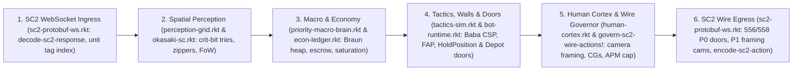

# Mothman SC2 Bot & S2Protocol Sidecar (`#lang sc-bot`)

**Mothman SC2 Bot** (`sticklane/mothman-sc2-bot`) is a pure-Racket StarCraft II ladder bot suite built on `#lang sc-bot`, paired with a high-performance Rust **`s2protocol-sidecar`** (`crates/s2protocol-sidecar/`) for live `.SC2Replay` telemetry, minimap playback, and AI Arena diagnostics.

---

## Architecture Overview

### 1. `#lang sc-bot` Compiler & Race Bots
- **Language & Syntax (`info.rkt`, `main.rkt`, `compiler/syntax.rkt`)**: Coeffect/capability-graded DSL compiling bot definitions, build orders, and capability checks in pure Racket.
- **Ladder Entrypoints (`bots/`, `examples/`, `ladder/`)**:
  - Active ladder variants built by [`ladder/build-aiarena-zip.rkt`](ladder/build-aiarena-zip.rkt): **`Mothman-X`** (Random), **`Mothman-Z`** (Zerg), **`Mothman-T`** (Terran), and **`Mothman-P`** (Protoss).
  - Archetype definitions live in [`examples/`](examples/) (`zerg-overmind-12hatch.rkt`, `terran-pluto-siege-ghost.rkt`, `protoss-stardust-ffe.rkt`, `random-chameleon-allrace.rkt`) with entry stubs in [`bots/`](bots/) and [`config.json`](config.json).

### 2. Core Racket Engine (`lib/`)
- **Macro, Economy & Priority Scheduling**:
  - [`lib/priority-macro-brain.rkt`](lib/priority-macro-brain.rkt) — Priority/Braun-heap scheduler with facility-slot escrow, saving-for locks, and 8-stream resource bank allocation.
  - [`lib/econ-ledger.rkt`](lib/econ-ledger.rkt) — Symbiotic resource reservation, preemption ledger, worker saturation, and late-game supply management.
  - [`lib/zerospace-mastermind.rkt`](lib/zerospace-mastermind.rkt) & [`lib/mirror-mind-predictor.rkt`](lib/mirror-mind-predictor.rkt) — Counter-tree planning, hidden-tech FoW inference, and $k$-level opponent modeling.
- **Tactical Simulation, Walling & Door Management**:
  - [`lib/tactics-sim.rkt`](lib/tactics-sim.rkt) — Baba CSP & terrain-grid ramp/choke wall solvers (`solve-terran-ramp-wall`, `solve-protoss-matchup-wall`), FAP combat evaluation + hysteresis, traffic-aware retreat, and in-progress order ledger.
  - [`lib/bot-runtime.rkt`](lib/bot-runtime.rkt) — 5-layer live step loop (`step-live-bot-runtime!`), Protoss `HoldPosition` wall door-guard state machine (`open`/`closed` transit & trapped-unit unstick), and Terran Supply Depot front-door state tracking & unstick pathing.
  - [`lib/perception-grid.rkt`](lib/perception-grid.rkt) & [`lib/okasaki-sc.rkt`](lib/okasaki-sc.rkt) — Spatial threat sectors, crit-bit tries, 2–3 finger trees, and choke zippers.
- **Human-Cortex Camera Framing & APM Discipline**:
  - [`lib/human-cortex.rkt`](lib/human-cortex.rkt) — Fitts' law saccades, viewport gating (`action-requires-camera-focus`), control-group recall safety, and selection compiler (`compile-optimal-unit-selection!`).
- **Pure-Racket SC2 Protobuf WebSocket Wire Layer**:
  - [`lib/sc2-protobuf-ws.rkt`](lib/sc2-protobuf-ws.rkt), [`lib/sc2-typed-commands.rkt`](lib/sc2-typed-commands.rkt), [`lib/sc2-proto-wire-verifier.rkt`](lib/sc2-proto-wire-verifier.rkt), [`lib/sc2-common.rkt`](lib/sc2-common.rkt), [`lib/sc2-game-constants.rkt`](lib/sc2-game-constants.rkt) — Direct s2clientprotocol Protobuf/RFC 6455 WebSocket actuator, Terran depot `556`/`558` P0 raise/lower hysteresis with footprint/transit guards, un-control-grouped camera framing (`Tier 1`, `6`-loop large-jump cooldown), and rolling-window APM wire governor (`govern-sc2-wire-actions!`).
- **Replay Forensics & Verification**:
  - [`lib/sc2-mpq-replay-parser.rkt`](lib/sc2-mpq-replay-parser.rkt), [`lib/state-machine-verifier.rkt`](lib/state-machine-verifier.rkt), [`lib/bot-crash-fuzzer.rkt`](lib/bot-crash-fuzzer.rkt), [`lib/pro-replay-starvation-audit.rkt`](lib/pro-replay-starvation-audit.rkt).

### 3. Rust `s2protocol-sidecar` (`crates/s2protocol-sidecar/`)
Live HTTP/SSE server (`http://127.0.0.1:4322/`) and CLI analyzer powered by `s2protocol = "5.1.0"`:
- **Interactive Telemetry UI ([`crates/s2protocol-sidecar/sidecar-ui.html`](crates/s2protocol-sidecar/sidecar-ui.html))**:
  - HiDPI canvas minimap with cached static terrain/heatmap layers, camera viewport overlays (`P1 CAM`/`P2 CAM`, `cameras: true` by default), raised vs. lowered `SupplyDepot` indicators, combat vectors, win-probability timeline, and filter/search catalog controls.
  - **Native SC2 Observer Leader Panel** synced frame-by-frame during playback with dropdown/pills & keyboard hotkeys:
    - **`D`** Production (constructing buildings, Warp Gate warp-ins, training/morphing units, research progress bars)
    - **`U`** Active Units (workers + combat supply grouped by unit type)
    - **`G`** Upgrades & Research (completed upgrades, `+1/+2/+3` levels, active research)
    - **`V`** APM / EPM (rolling 22s current APM, average APM, average EPM)
    - **`L`** Units Lost (cumulative losses by type and mineral/vespene cost)
    - **`N`** Collapse Leader Panel
- **Server & CLI Modes ([`crates/s2protocol-sidecar/src/main.rs`](crates/s2protocol-sidecar/src/main.rs))**:
  - Endpoints: `GET /`, `GET /api/status`, `GET /api/catalog`, `GET /api/replay/<id>`, `POST /api/analyze-bytes`, `GET /api/events` (SSE).
  - CLI modes: `--serve --port 4322`, `--analyze <file.SC2Replay>`, `--batch-dir <dir>`, `--export-ui-bundle <out.json>`.

---

## How the Bot Works: 5-Layer Per-Step Runtime Pipeline

On every StarCraft II game step (driven natively by [`sim/racket-sc2-ladder-main.rkt`](sim/racket-sc2-ladder-main.rkt)), observations flow from Blizzard's Protobuf WebSocket API through the 5-layer Racket cognitive pipeline (`step-live-bot-runtime!`) and back out through the priority-tiered wire governor:



1. **Wire Ingress & Tactical Translation (`lib/sc2-protobuf-ws.rkt`)**:
   - `decode-sc2-response` unpacks raw protobuf `ResponseObservation` frames (game loop, units, orders, upgrades, power sources, active camera position, dead tags) into `sc2-observation`, while `sc2-observation->runtime-obs-hash` normalizes worker/facility counts, live unit-tag lookups, and base anchors for the runtime layers.
   - On egress, `translate-bot-actions->sc2-raw-commands` validates typed actions against live unit tags, evaluates Terran Supply Depot auto-raise (`558`) and auto-lower (`556`) hysteresis (`<= 10.0` raise vs. `> 14.5` or transit lower) guarded by `friendly-unit-on-depot-footprint?` and `friendly-unit-requesting-depot-transit?` with both promoted to `P0` in `wire-cmd-priority-tier`, and tracks `SC2-CONTROL-GROUPED-TAGS` (`0–7`) so commands targeting un-control-grouped units outside the viewport prepend a `Tier 1` framing `sc2-raw-camera-move`.
2. **Spatial Perception & Functional Indexing (`lib/perception-grid.rkt` & `lib/okasaki-sc.rkt`)**:
   - `step-layer1-perception!` ingests allied and enemy unit snapshots into Morton 2D Z-order `critbit-range-2d` spatial tries (`okasaki-sc.rkt`), 2–3 monoidal combat finger trees (`split-by-dps`), and persistent skew-binary frame histories.
   - `lakefill-choke-decomposition` and `huet-zipper` model base/natural/third ramp chokes with $O(1)$ rollback, while `fow-ghost-step-diffusion!` and `best-retreat-sector` track sector threat weights and FoW persistence.
3. **Priority Macro, Tech DAG & Escrow Economy (`lib/priority-macro-brain.rkt` & `lib/econ-ledger.rkt`)**:
   - `step-layer1b-mastermind!`, `step-layer1c-mirror-mind!`, and `step-layer2-economy!` build a decoupled `macro-world-state` via `obs-hash->macro-world-state` and run `step-priority-macro-brain` over `SC2-TECH-GRAPH` (checking prerequisites via `resolve-missing-prereq-chain`).
   - Pointerless Braun priority queues (`braun-insert`) rank competing spending goals alongside symbiotic escrow reservations (`make-symbiotic-ledger`, `ledger-reserve!`, `ledger-preempt-for-crisis!`) and `macro-brain-can-spend?` locks, while `evaluate-coupled-macro-governor` balances expansion timing, worker saturation (`22`/base), and multi-stream mineral/gas/supply budgets.
4. **Tactics, Ramp Walling & Front-Door Guards (`lib/tactics-sim.rkt` & `lib/bot-runtime.rkt`)**:
   - `step-layer3-and-4-tactics!` runs Baba CSP and terrain-grid wall solvers (`solve-terran-ramp-wall`, `solve-protoss-matchup-wall`) verified against ramp pathing/placement/height grids, `fap-posture-with-hysteresis` for engagement posture stability, `purplewave-traffic-retreat` for choke-aware disengages, and `in-progress-order-ledger` to avoid canceling in-flight build orders.
   - Protoss `HoldPosition` doorway micro (`rt-door-state`: `'open`/`'closed`) parts its Zealot/Stalker wall guard for transiting workers or `>= 1` trapped combat unit when enemies are `> 6.5` tiles away, nudges idle trapped units across the opening, and re-seals immediately; Terran doorway tracking (`rt-door-state`) monitors `supply-depot`/`supply-depot-lowered` transitions and emits unstick `move` pathing after `>= 2` trapped frames.
5. **Human-Cortex Framing & Wire APM Governor (`lib/human-cortex.rkt` & `govern-sc2-wire-actions!`)**:
   - `step-layer5-human-cortex!` models human attention with `fitts-saccade-ms` camera fixations and `in-camera-viewport?` gating: `action-requires-camera-focus` emits `(move-camera fx fy)` immediately before spatial builds or un-control-grouped unit commands outside the current viewport, while `compile-optimal-unit-selection!` only recalls a control group when all desired unit IDs belong to it.
   - `step-pro-human-camera-and-apm-governor!` filters runtime directives, and `govern-sc2-wire-actions!` enforces the rolling 60-second replay APM/token cap (`target-apm`/`hard-cap-apm`), coalesces compatible multi-tag unit commands, keeps `P0` depot/survival actions unthrottled, prioritizes framing camera moves at `Tier 1` with a `6`-loop cooldown for `> 10.0`-tile jumps (`28` loops for routine `Tier 4` moves), and preserves camera-before-command ordering before `encode-sc2-action` transmits bytes on the wire.

---

## Pure-Racket Tooling Policy (`AGENTS.md`)

All bot logic, MPQ/`.SC2Replay` analysis, AI Arena API tools, and test scripts in this repository follow a **strict 100% Pure-Racket policy** (no `python3` or new `*.py` scripts for analysis or tooling). Canonical CLI tools live in [`tools/`](tools/):
- [`tools/aiarena-api-client.rkt`](tools/aiarena-api-client.rkt) — AI Arena BotZip sync, match requests, and status polling
- [`tools/analyze-aiarena-replays.rkt`](tools/analyze-aiarena-replays.rkt) — AI Arena replay & match telemetry forensics
- [`tools/run-real-sc2-bot-match.rkt`](tools/run-real-sc2-bot-match.rkt) — Headless `SC2_x64` match harness
- [`tools/audit-pro-replay-starvation.rkt`](tools/audit-pro-replay-starvation.rkt) & [`tools/racket-multi-match-validator.rkt`](tools/racket-multi-match-validator.rkt) — Starvation & multi-match validation
- [`tools/fuzz-sc2-protobuf-output.rkt`](tools/fuzz-sc2-protobuf-output.rkt) — Protobuf differential schema fuzzer

Default test execution in [`tests/run-all-tests.rkt`](tests/run-all-tests.rkt) is kept strictly under `< 5,000 ms` (`FAST-<5s` mode; compile first with `raco make -j 4`).

---

## Build & Test Commands

```bash
# 1. Compile and run the full #lang sc-bot verification suite (< 5s fast mode)
raco make -j 4 tests/run-all-tests.rkt && racket tests/run-all-tests.rkt

# 2. Run the pure-Racket Protobuf + RFC 6455 WebSocket suite
raco make -j 4 tests/sc2-protobuf-ws-test.rkt && racket tests/sc2-protobuf-ws-test.rkt

# 3. Run the Rust s2protocol-sidecar test suite
cargo test --manifest-path crates/s2protocol-sidecar/Cargo.toml

# 4. Run the live sidecar daemon at http://127.0.0.1:4322/
cargo run --release --manifest-path crates/s2protocol-sidecar/Cargo.toml -- --serve --port 4322
```
